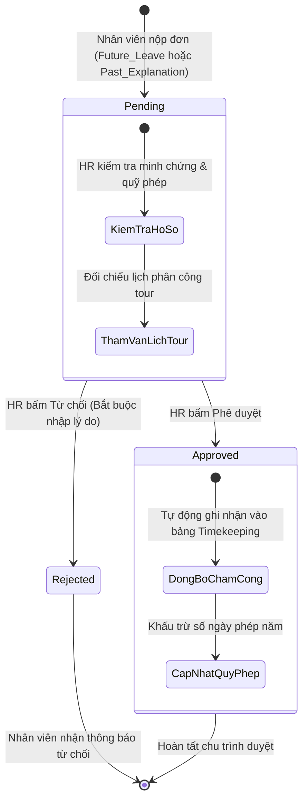
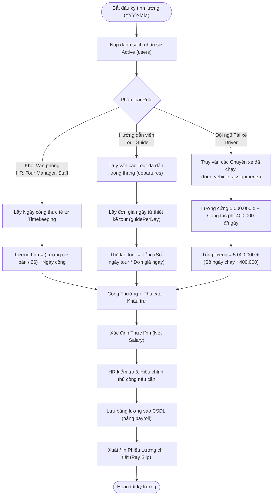

# BÁO CÁO PHÂN TÍCH NGHIỆP VỤ VÀ PHẠM VI HỆ THỐNG
## VAI TRÒ: QUẢN LÝ NHÂN SỰ (HR MANAGER) – TRAVELVN ERP

---

### 1. Tổng quan vai trò Quản lý Nhân sự trong Hệ thống TravelVN ERP

Trong kiến trúc điều hành tổng thể của doanh nghiệp lữ hành **TravelVN ERP**, **Quản lý Nhân sự (HR Manager - Role ID: 2)** là tác nhân chịu trách nhiệm quản trị nguồn nhân lực cốt lõi – tài sản quan trọng nhất trong ngành dịch vụ du lịch. Phạm vi quản trị của HR Manager bao quát toàn bộ vòng đời nhân viên trong tổ chức:
- **Quản trị hồ sơ & Cơ cấu tổ chức:** Định danh, quản lý thông tin và phân quyền cho toàn bộ các nhóm vị trí: Quản trị viên (`role_id = 1`), Quản lý Nhân sự (`role_id = 2`), Quản lý Tour (`role_id = 3`), Nhân viên văn phòng (`role_id = 4`), Hướng dẫn viên du lịch (`role_id = 5`) và Đội ngũ Tài xế (`role_id = 8`).
- **Giám sát thời gian & Chuyên cần:** Quản lý chấm công đa phương thức (tích hợp GPS định vị tại văn phòng/tour và nhận diện sinh trắc học khuôn mặt), cấu hình ca làm việc và giải quyết chế độ nghỉ phép tự động.
- **Đãi ngộ & Lương thưởng đặc thù:** Tính toán và chi trả bảng lương phân hóa sâu sắc theo tính chất công việc: lương hành chính theo ngày công văn phòng đối chiếu với thù lao biến đổi theo ngày dẫn tour của Hướng dẫn viên và công tác phí chạy xe thực tế của Tài xế.
- **Đánh giá & Phát triển nhân tài:** Thiết lập chỉ số KPI và ghi nhận đánh giá định kỳ về tác phong, năng lực phục vụ du khách để làm cơ sở đãi ngộ và đào tạo.

---

### 2. Ma trận phân nhiệm trách nhiệm (RACI Matrix)

*Quy ước:*
- **R (Responsible):** Người trực tiếp thực hiện tác vụ.
- **A (Accountable):** Người chịu trách nhiệm phê duyệt cuối cùng và kết quả tác vụ.
- **C (Consulted):** Người được tham vấn, phối hợp cung cấp thông tin.
- **I (Informed):** Người nhận thông báo kết quả.

| Use Case Nghiệp Vụ | Quản Lý Nhân Sự (HR Manager) | Quản Trị Viên (Admin) | Quản Lý Tour (Tour Manager) | Nhân Viên Nội Bộ (Employees) | Kế Toán (Accountant) |
| :--- | :---: | :---: | :---: | :---: | :---: |
| **`UC-HR-01: Quản lý hồ sơ nhân sự`** | **R / A** | A | C (Tham vấn nhu cầu nhân sự) | I | I |
| **`UC-HR-02: Quản lý chấm công và ca làm việc`** | **R / A** | A | I | R (Thực hiện điểm danh) | I |
| **`UC-HR-03: Phê duyệt đơn nghỉ phép & giải trình`** | **R / A** | A | C (Xác nhận lịch tour) | R (Nộp đơn) / I | I |
| **`UC-HR-04: Tính toán và quản lý bảng lương`** | **R / A** | A | C (Xác nhận ngày tour) | I (Nhận phiếu lương) | C / A (Chi trả tiền) |
| **`UC-HR-05: Đánh giá hiệu suất nhân sự`** | **R / A** | A | C (Đánh giá chuyên môn) | I | I |

---

### 3. Phân tích luồng nghiệp vụ và trạng thái vòng đời dữ liệu

#### 3.1. Sơ đồ trạng thái Đơn xin nghỉ phép và Giải trình chấm công (`UC-HR-03`)

#### 3.2. Sơ đồ luồng tính lương phân hóa theo từng vị trí công việc (`UC-HR-04`)

---

### 4. Phân tích chi tiết quy tắc nghiệp vụ (Business Rules)

1. **Quy tắc Kiểm soát Chuyên cần và Chấm công Thông minh:**
   - Việc chấm công hàng ngày được tự động hóa qua việc kiểm tra chéo hai yếu tố: Bán kính định vị GPS tại vị trí văn phòng/điểm đón đoàn (sai số cho phép <= 150m) và Độ khớp nhận diện khuôn mặt AI (tỷ lệ tin cậy >= 70%).
   - Trường hợp nhân viên quên chấm công hoặc gặp lỗi thiết bị khi đi tour xa, nhân viên bắt buộc phải gửi đơn giải trình quá khứ (`Past_Explanation`) kèm minh chứng. Khi Quản lý Nhân sự phê duyệt, hệ thống sẽ tự động cập nhật giờ vào/ra chuẩn xác vào cơ sở dữ liệu thay vì sửa dữ liệu một cách tùy tiện không lưu vết.

2. **Quy tắc Tính thù lao biến đổi cho lực lượng phục vụ hiện trường:**
   - Doanh nghiệp lữ hành có đặc thù là Hướng dẫn viên và Tài xế không làm việc theo giờ hành chính cố định tại văn phòng mà phụ thuộc vào từng đoàn tour cụ thể.
   - Thù lao của Hướng dẫn viên được liên kết trực tiếp với dự toán chi phí đã được chốt trong Thiết kế tour (`design_data.costConfig.fixed.guidePerDay`). Nếu một tour có độ khó cao hoặc ngoại ngữ hiếm (đơn giá 1.000.000 ₫/ngày), hệ thống tự động ghi nhận mức thù lao này cho HDV, bảo đảm tính công bằng và minh bạch tuyệt đối.

3. **Nguyên tắc Phân định Trách nhiệm và Bảo mật Thông tin:**
   - Dữ liệu lương và hồ sơ lý lịch nhân sự là thông tin nội bộ bảo mật cấp cao, chỉ có Quản lý Nhân sự (`role_id = 2`) và Quản trị viên (`role_id = 1`) mới có quyền truy cập tổng thể.
   - Nhân viên chỉ được xem phiếu lương và lịch sử chấm công của chính bản thân mình; Quản lý Tour chỉ được xem danh sách nhân sự để phân công điều hành mà không có quyền xem thông tin tiền lương cá nhân.
