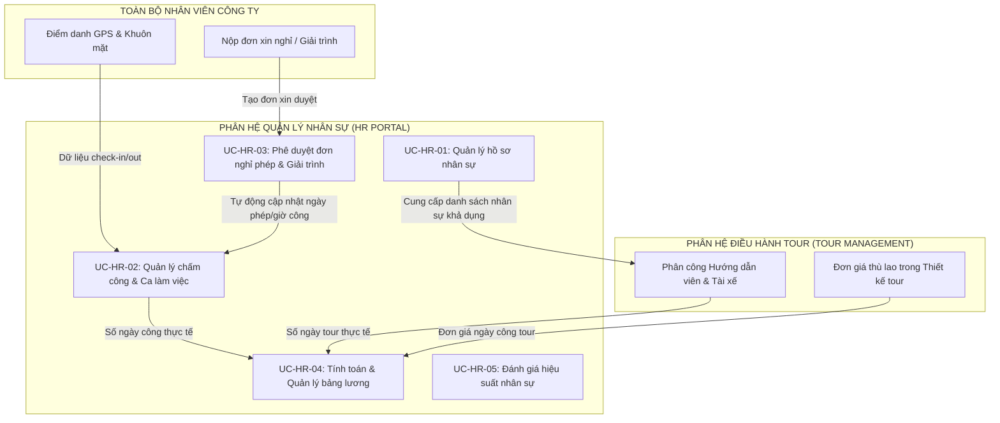

# BẢNG KIỂM KÊ VÀ ÁNH XẠ KỸ THUẬT USE CASE (USE CASE INVENTORY)
## PHÂN HỆ: QUẢN LÝ NHÂN SỰ (HR MANAGEMENT) – TRAVELVN ERP

---

### 1. Tổng quan phạm vi nghiệp vụ
Tài liệu này xác lập danh mục và bảng ánh xạ kỹ thuật truy vết cho **5 Use Case nghiệp vụ** thuộc phạm vi tác nhân **Quản lý Nhân sự (HR Manager - Role ID: 2)** trong Hệ thống Quản trị và Điều hành Du lịch **TravelVN ERP**.

Danh mục 5 Use Case cơ sở bao gồm:
1. `UC-HR-01`: Quản lý hồ sơ nhân sự
2. `UC-HR-02`: Quản lý chấm công và ca làm việc
3. `UC-HR-03`: Phê duyệt đơn nghỉ phép và giải trình chấm công
4. `UC-HR-04`: Tính toán và quản lý bảng lương
5. `UC-HR-05`: Đánh giá hiệu suất nhân sự

---

### 2. Bảng kiểm kê trạng thái triển khai Use Case

| STT | Mã Use Case | Tên Use Case | Phân hệ nghiệp vụ | Trạng thái triển khai | Mức độ ưu tiên |
| :---: | :--- | :--- | :--- | :---: | :---: |
| 1 | `UC-HR-01` | Quản lý hồ sơ nhân sự | Quản trị tổ chức & Nhân sự | **Đã xác minh qua mã nguồn** | Cao |
| 2 | `UC-HR-02` | Quản lý chấm công và ca làm việc | Quản lý công & Thời gian | **Đã xác minh qua mã nguồn** | Cao |
| 3 | `UC-HR-03` | Phê duyệt đơn nghỉ phép và giải trình chấm công | Quản trị chế độ & Phép | **Đã xác minh qua mã nguồn** | Cao |
| 4 | `UC-HR-04` | Tính toán và quản lý bảng lương | Đãi ngộ & Tiền lương | **Đã xác minh qua mã nguồn** | Cao |
| 5 | `UC-HR-05` | Đánh giá hiệu suất nhân sự | Đánh giá & Phát triển nhân sự | **Đã xác minh qua mã nguồn** | Trung bình |

---

### 3. Ma trận ánh xạ kỹ thuật (Technical Traceability Matrix)

| Mã UC | Tên Use Case | Component Giao diện (Frontend) | Tuyến đường (Route / Tab) | Phương thức & API Endpoint Backend | File xử lý Backend (Controller) | Bảng dữ liệu tác động (MySQL) |
| :--- | :--- | :--- | :--- | :--- | :--- | :--- |
| `UC-HR-01` | Quản lý hồ sơ nhân sự | `HREmployeeManagement.jsx` | Tab `hr_employees` | `GET /api/hr/employees` `POST /api/hr/employees` `PUT /api/hr/employees/:id` `DELETE /api/hr/employees/:id` `GET /api/hr/employees/:id/tour-stats` | `microservices/hr-service/controllers/hrController.js` | `users`, `roles`, `departures`, `tours` |
| `UC-HR-02` | Quản lý chấm công và ca làm việc | `HRAttendance.jsx` | Tab `hr_attendance` | `GET /api/hr/attendance?date=YYYY-MM-DD` `GET /api/hr/attendance/history` `POST /api/hr/attendance` | `microservices/hr-service/controllers/hrController.js` | `timekeeping`, `users`, `roles` |
| `UC-HR-03` | Phê duyệt đơn nghỉ phép và giải trình chấm công | `HRAttendance.jsx` (sub-tab requests) / `HRLeaveRequest.jsx` (`mode="approval"`) | Tab `hr_attendance` / `leave_requests` | `GET /api/hr/leave-requests/all` `PUT /api/hr/leave-requests/:id/review` | `microservices/hr-service/controllers/hrController.js` | `leave_requests`, `timekeeping`, `users`, `roles` |
| `UC-HR-04` | Tính toán và quản lý bảng lương | `HRPayroll.jsx` | Tab `hr_payroll` | `GET /api/hr/payroll?month=YYYY-MM` `POST /api/hr/payroll` | `microservices/hr-service/controllers/hrController.js` | `payroll`, `users`, `roles`, `timekeeping`, `departures`, `tours` |
| `UC-HR-05` | Đánh giá hiệu suất nhân sự | `HRPerformanceReview.jsx` | Tab `hr_performance` | `GET /api/hr/performance` `POST /api/hr/performance` | `microservices/hr-service/controllers/hrController.js` | `performance_reviews`, `users`, `roles` |

---

### 4. Tóm tắt kết quả kiểm chứng mã nguồn thực tế

1. **`UC-HR-01` (Quản lý hồ sơ nhân sự):**
   - **Xác minh chức năng:** Quản lý Nhân sự xem được toàn bộ danh mục nhân sự nội bộ (trừ khách hàng role 6 và đối tác role 7) qua API `GET /api/hr/employees`.
   - **Thêm mới & Cập nhật:** Endpoint `POST /api/hr/employees` kiểm tra trùng lặp email, mã hóa mật khẩu bằng `bcrypt.hash`, gán vai trò tương ứng (`role_id = 2, 3, 4, 5, 8`) và cập nhật trạng thái làm việc (`Active`, `Inactive`, `Blocked`).
   - **Thống kê tour đã đi:** Endpoint `GET /api/hr/employees/:id/tour-stats` thống kê tổng số đoàn đã dẫn, tổng doanh thu và đánh giá sao trung bình của Hướng dẫn viên và Tài xế.
   - **Giới hạn thực tế:** Việc xóa nhân viên thực hiện qua kiểm tra ràng buộc khóa ngoại; nhân sự đã phát sinh lịch sử chấm công hay phân công tour được khuyến nghị chuyển trạng thái sang `Blocked` thay vì xóa cứng.

2. **`UC-HR-02` (Quản lý chấm công và ca làm việc):**
   - **Xác minh chức năng:** Hỗ trợ xem ma trận chấm công cả tháng dạng lưới (`summary`) cho từng ngày từ 1 đến 31, và xem chi tiết theo ngày (`daily_detail`).
   - **Tích hợp chấm công công nghệ cao:** Ghi nhận tọa độ GPS (`latitude`, `longitude`, `location_address`), tỷ lệ nhận diện khuôn mặt (`face_verified`, `match_confidence`) và ảnh chụp check-in (`face_image_url`).
   - **Cấu hình ca & Xuất báo cáo:** Hỗ trợ thiết lập ca làm việc (`company_shifts`), thời gian ân hạn 15 phút, xuất tệp CSV báo cáo chấm công tháng với chuẩn mã hóa tiếng Việt có dấu.

3. **`UC-HR-03` (Phê duyệt đơn nghỉ phép và giải trình chấm công):**
   - **Xác minh chức năng:** Endpoint `GET /api/hr/leave-requests/all` hỗ trợ lọc theo trạng thái (`Pending`, `Approved`, `Rejected`) và loại đơn (`Future_Leave`, `Past_Explanation`).
   - **Tự động hóa đồng bộ bảng công:** Endpoint `PUT /api/hr/leave-requests/:id/review` khi chuyển trạng thái `Approved` sẽ:
     - Với đơn nghỉ phép tương lai (`Future_Leave`): Tự động duyệt qua từng ngày trong khoảng thời gian nghỉ (`start_date` đến `end_date`), ghi nhận bản ghi `status = 'Leave'` vào bảng `timekeeping`.
     - Với đơn giải trình chấm công quá khứ (`Past_Explanation`): Cập nhật giờ vào/ra đề xuất vào bảng `timekeeping` của ngày `target_date`, tự động phân loại đúng giờ (`Present`) hoặc đi muộn (`Late`).

4. **`UC-HR-04` (Tính toán và quản lý bảng lương):**
   - **Xác minh chức năng:** Endpoint `GET /api/hr/payroll?month=YYYY-MM` thực hiện đa luồng nghiệp vụ tính toán:
     - Khối văn phòng: Tính lương theo công chuẩn (`base_salary / 26 * working_days`).
     - Hướng dẫn viên: Lấy đơn giá dẫn tour từ cấu hình chi phí thiết kế tour (`design_data.costConfig.fixed.guidePerDay`) nhân với số ngày tour thực tế.
     - Tài xế: Tính lương cứng 5.000.000 ₫ cộng công tác phí 400.000 ₫/ngày tour phục vụ đoàn.
   - **Lưu trữ & In ấn:** Endpoint `POST /api/hr/payroll` lưu bảng lương vào bảng `payroll`. Hỗ trợ Modal in phiếu lương chi tiết (`selectedSlip`) có thể in trực tiếp hoặc lưu PDF.

5. **`UC-HR-05` (Đánh giá hiệu suất nhân sự):**
   - **Xác minh chức năng:** Endpoint `GET /api/hr/performance` truy vấn toàn bộ lịch sử đánh giá nhân sự.
   - **Tạo mới đánh giá:** Endpoint `POST /api/hr/performance` lưu bản ghi đánh giá gồm: `employee_id`, `score` (thang điểm 0-100), `comment` và `review_date` vào bảng `performance_reviews`.

---

### 5. Mối quan hệ tương hỗ giữa Phân hệ HR và các phân hệ khác

