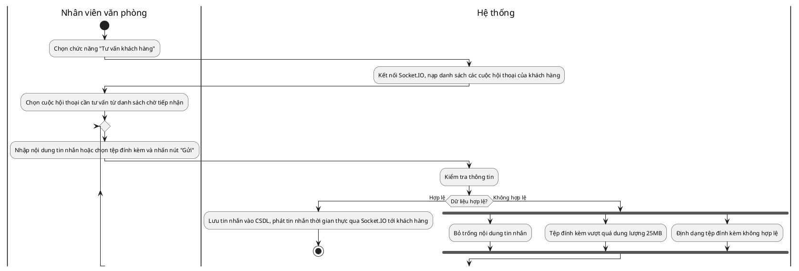
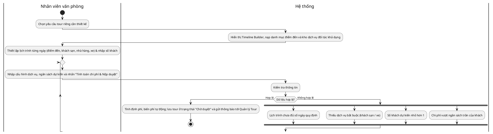
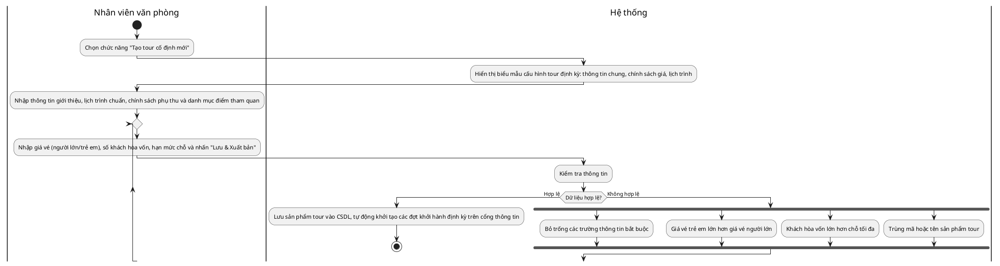
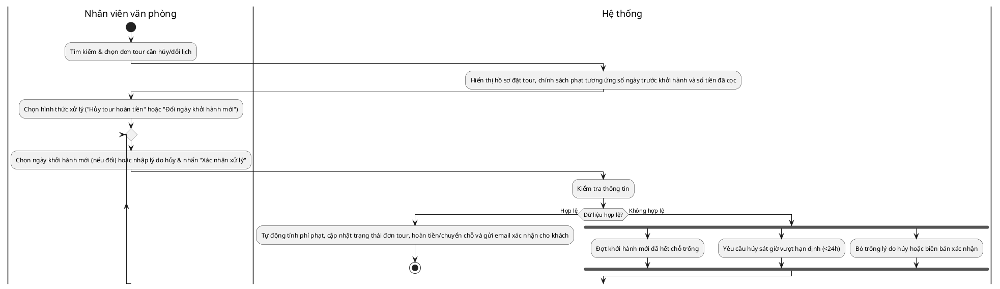
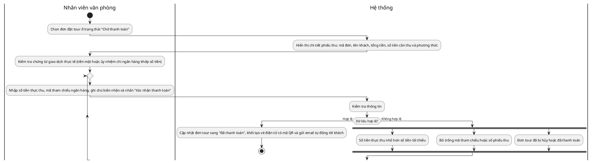
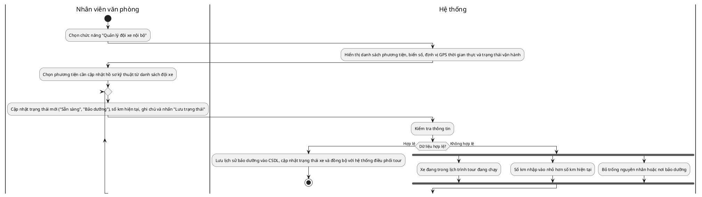
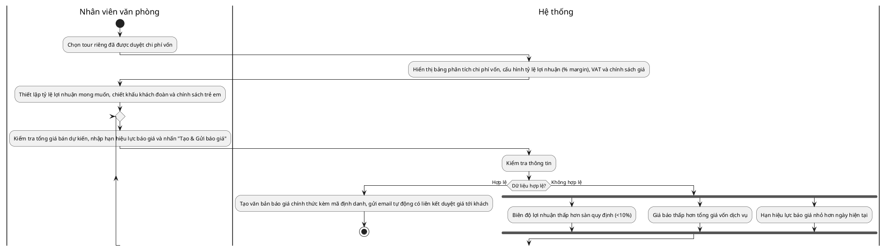
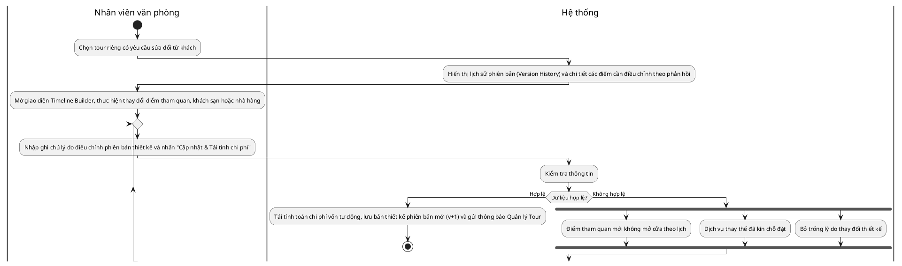

# TÀI LIỆU THIẾT KẾ SƠ ĐỒ HOẠT ĐỘNG (ACTIVITY DIAGRAMS)
## PHÂN HỆ: NHÂN VIÊN VĂN PHÒNG (OFFICE STAFF – ROLE ID: 4) – TRAVELVN ERP

---

### PHẦN I. TỔNG QUAN VÀ QUY CHUẨN MÔ HÌNH HÓA (VISUAL PARADIGM STANDARD)

#### 1. Mục tiêu tài liệu
Tài liệu này chuẩn hóa và trực quan hóa toàn bộ luồng quy trình nghiệp vụ cho **9 Use Case cốt lõi** thuộc vai trò **Nhân viên văn phòng (Office Staff - Role ID: 4)** trong Hệ thống Quản trị và Điều hành Du lịch **TravelVN ERP**. Bản thiết kế được xây dựng theo chuẩn **UML 2.0 Activity Diagram phân làn (Swimlane Activity Diagram)** dựa trên cấu trúc mô hình hóa chuẩn mực của công cụ **Visual Paradigm** (khớp 100% với mẫu tài liệu thiết kế hệ thống tốt nghiệp).

#### 2. Quy chuẩn cấu trúc Sơ đồ Hoạt động 2 phân làn (Swimlanes Pattern)

Mỗi sơ đồ hoạt động được phân tách thành 2 làn bơi (Swimlanes) trực giao rõ ràng với đường phân cách thẳng đứng:
1. **Làn bên trái – Tác nhân (Actor): Nhân viên văn phòng**
   - Chứa điểm bắt đầu luồng (Initial Node ⚫).
   - Biểu diễn các hành động tương tác: Chọn chức năng, chọn hồ sơ/cuộc hội thoại, nhập dữ liệu biểu mẫu và nhấn nút xác nhận/gửi.
   - Nhận mũi tên hồi tiếp mang nhãn **"Nhập lại thông tin"** từ Làn Hệ thống trỏ trực tiếp vào ô nhập liệu khi dữ liệu không vượt qua khâu kiểm tra.
2. **Làn bên phải – Hệ thống (System): TravelVN ERP**
   - Biểu diễn các tác vụ: Hiển thị giao diện, tải dữ liệu danh mục, kết nối WebSocket.
   - Chứa hành động thẩm định: **"Kiểm tra thông tin"** dẫn vào **Nút quyết định (Decision Node ◇)**.
   - **Cơ chế rẽ nhánh lỗi (Visual Paradigm Pattern):**
     - Nhánh **[Không hợp lệ]** đi lên và phân nhánh song song vào các ô mô tả điều kiện lỗi cụ thể (ví dụ: *Bỏ trống trường thông tin*, *Số khách hòa vốn < 1*, *Dung lượng file > 25MB*...).
     - Các nhánh lỗi được gom tụ lại tại **Nút hợp nhất (Merge Node ◇)** phía trên.
     - Từ nút hợp nhất, mũi tên mang nhãn **"Nhập lại thông tin"** chạy ngang qua vách ngăn sang làn Người dùng trỏ ngược vào ô nhập liệu.
     - Nhánh **[Hợp lệ]** đi xuống tác vụ xử lý thành công (Lưu CSDL, phát thông báo, xuất vé QR) và kết thúc tại **Nút kết thúc hoạt động (Activity Final Node ◉)**.

#### 3. Danh mục 9 Sơ đồ Hoạt động

| STT | Mã Use Case | Tên Use Case | Phân hệ nghiệp vụ | Loại nghiệp vụ |
| :---: | :--- | :--- | :--- | :---: |
| 1 | **`UC-OS-01`** | **Tư vấn khách hàng** | Chăm sóc khách hàng | Trực tuyến thời gian thực (Live Chat) |
| 2 | **`UC-OS-02`** | **Thiết kế tour riêng** | Quản lý thiết kế tour | Thiết kế lịch trình & Tính giá vốn |
| 3 | **`UC-OS-03`** | **Thiết kế tour cố định** | Quản lý sản phẩm tour | Xây dựng sản phẩm tour mở bán |
| 4 | **`UC-OS-04`** | **Xử lý hủy, đổi lịch** | Quản trị đơn đặt tour | Thẩm định hoàn tiền & Biểu phí phạt |
| 5 | **`UC-OS-05`** | **Xác nhận thanh toán** | Quản lý thanh toán | Xác nhận tiền mặt & Xuất vé QR |
| 6 | **`UC-OS-06A`** | **Theo dõi & cập nhật trạng thái xe** | Quản lý đội xe nội bộ | Điều chuyển bảo dưỡng / Sửa chữa |
| 7 | **`UC-OS-06B`** | **Tiếp nhận & xử lý sự cố xe** | Quản lý đội xe nội bộ | Tiếp nhận báo cáo & Nghiệm thu xe |
| 8 | **`UC-OS-07`** | **Báo giá & điều chỉnh báo giá tour riêng** | Quản lý báo giá | Báo giá sơ bộ & Chính sách trẻ em |
| 9 | **`UC-OS-08`** | **Chỉnh sửa thiết kế tour** | Quản lý thiết kế tour | Hoàn thiện thiết kế theo góp ý |

---

### PHẦN II. CHI TIẾT 9 SƠ ĐỒ HOẠT ĐỘNG PHÂN LÀN (VISUAL PARADIGM FORMAT)

---

#### 1. SƠ ĐỒ HOẠT ĐỘNG UC-OS-01: Tư vấn khách hàng (Live Chat)

##### 1.1. Bảng đặc tả các bước thực thi trên sơ đồ
| Bước | Phân làn (Swimlane) | Hành động / Tác vụ | Mô tả chi tiết |
| :---: | :--- | :--- | :--- |
| **1** | Nhân viên văn phòng | Điểm bắt đầu (Initial Node ⚫) | Nhân viên đăng nhập thành công vào phân hệ Office Staff. |
| **2** | Nhân viên văn phòng | `Chọn chức năng "Tư vấn khách hàng"` | Chọn chức năng nghiệp vụ từ thanh điều hướng. |
| **3** | Hệ thống | `Kết nối Socket.IO, nạp danh sách các cuộc hội thoại của khách hàng` | Hệ thống tải giao diện và dữ liệu tương ứng từ máy chủ. |
| **4** | Nhân viên văn phòng | `Chọn cuộc hội thoại cần tư vấn từ danh sách chờ tiếp nhận` | Nhân viên chọn đối tượng dữ liệu cụ thể cần thao tác. |
| **5** | Nhân viên văn phòng | `Nhập nội dung tin nhắn hoặc chọn tệp đính kèm và nhấn nút "Gửi"` | Điền thông tin vào form biểu mẫu và nhấn nút thực hiện. |
| **6** | Hệ thống | **Kiểm tra thông tin** | Hệ thống thẩm định tính hợp lệ của toàn bộ dữ liệu đầu vào. |
| **7** | Hệ thống | Rẽ nhánh quyết định (Decision Node ◇) | Phân tách luồng xử lý: **[Hợp lệ]** hoặc **[Không hợp lệ]**. |
| **8a** | Hệ thống (Nhánh lỗi) | Phân nhánh điều kiện lỗi song song | Hiển thị chi tiết các vi phạm: <br>• Bỏ trống nội dung tin nhắn<br>• Tệp đính kèm vượt quá dung lượng 25MB<br>• Định dạng tệp đính kèm không hợp lệ |
| **8b** | Hệ thống $\rightarrow$ NVVP | Gom nhánh (Merge Node ◇) & Loopback | Gắn nhãn **"Nhập lại thông tin"** quay ngược về bước nhập liệu của Nhân viên. |
| **9** | Hệ thống (Hợp lệ) | `Lưu tin nhắn vào CSDL, phát tin nhắn thời gian thực qua Socket.IO tới khách hàng` | Lưu CSDL, cập nhật trạng thái, phát thông báo tới các bên liên quan. |
| **10** | Hệ thống | Điểm kết thúc (Final Node ◉) | Hoàn thành phiên làm việc của Use Case. |

##### 1.2. Biểu diễn đồ họa trực quan (Vector SVG - Chuẩn Visual Paradigm)
```xml
<svg width="920" height="740" viewBox="0 0 920 740" xmlns="http://www.w3.org/2000/svg" style="background:#fff; font-family: -apple-system, BlinkMacSystemFont, 'Segoe UI', Roboto, Helvetica, Arial, sans-serif;">
  <defs>
    <marker id="ar_UC-OS-01" viewBox="0 0 10 10" refX="7" refY="5" markerWidth="6" markerHeight="6" orient="auto-start-reverse">
      <path d="M 0 1.5 L 8 5 L 0 8.5 z" fill="#000"/>
    </marker>
  </defs>

  <!-- Outer frame and swimlane header -->
  <rect x="20" y="20" width="880" height="700" fill="#fff" stroke="#000" stroke-width="2"/>
  <line x1="460" y1="20" x2="460" y2="720" stroke="#000" stroke-width="1.5"/>
  <line x1="20" y1="65" x2="900" y2="65" stroke="#000" stroke-width="1.5"/>

  <!-- Column Headers -->
  <text x="240" y="48" font-size="15" font-weight="bold" text-anchor="middle" fill="#000">Nhân viên văn phòng</text>
  <text x="680" y="48" font-size="15" font-weight="bold" text-anchor="middle" fill="#000">Hệ thống</text>

  <!-- Start Node -->
  <circle cx="240" cy="95" r="11" fill="#000"/>
  <line x1="240" y1="106" x2="240" y2="135" stroke="#000" stroke-width="1.5" marker-end="url(#ar_UC-OS-01)"/>

  <!-- Action 1 (Actor): Chọn chức năng -->
  <rect x="100" y="135" width="280" height="46" rx="12" fill="#e2e8f0" stroke="#000" stroke-width="1.4"/>
  <text x="240" y="163" font-size="12" font-weight="500" text-anchor="middle" fill="#000">Chọn chức năng &quot;Tư vấn khách hàng&quot;</text>

  <!-- Arrow Act 1 -> Sys 1 -->
  <path d="M 380 158 L 525 159" stroke="#000" stroke-width="1.5" marker-end="url(#ar_UC-OS-01)"/>

  <!-- Action 2 (System): Hiển thị giao diện / dữ liệu -->
  <rect x="525" y="135" width="310" height="48" rx="12" fill="#e2e8f0" stroke="#000" stroke-width="1.4"/>
  <text x="680" y="155" font-size="12" font-weight="500" text-anchor="middle" fill="#000">Kết nối Socket.IO, nạp danh sách</text>
  <text x="680" y="171" font-size="12" font-weight="500" text-anchor="middle" fill="#000">các cuộc hội thoại của khách hàng</text>

  <!-- Arrow Sys 1 -> Act 2 -->
  <path d="M 525 178 L 240 178 L 240 220" stroke="#000" stroke-width="1.5" marker-end="url(#ar_UC-OS-01)"/>

  <!-- Action 3 (Actor): Lựa chọn / Xem chi tiết -->
  <rect x="95" y="220" width="290" height="50" rx="12" fill="#e2e8f0" stroke="#000" stroke-width="1.4"/>
  <text x="240" y="241" font-size="12" font-weight="500" text-anchor="middle" fill="#000">Chọn cuộc hội thoại cần tư vấn</text>
  <text x="240" y="258" font-size="12" font-weight="500" text-anchor="middle" fill="#000">từ danh sách chờ tiếp nhận</text>

  <!-- Line Act 2 -> Act Input -->
  <line x1="240" y1="270" x2="240" y2="295" stroke="#000" stroke-width="1.5" marker-end="url(#ar_UC-OS-01)"/>

  <!-- Action 4 (Actor Input Box): Nhập biểu mẫu & Nhấn nút gửi/xác nhận -->
  <rect x="90" y="295" width="300" height="54" rx="12" fill="#e2e8f0" stroke="#000" stroke-width="1.4"/>
  <text x="240" y="317" font-size="12" font-weight="500" text-anchor="middle" fill="#000">Nhập nội dung tin nhắn hoặc chọn tệp đính kèm</text>
  <text x="240" y="334" font-size="12" font-weight="500" text-anchor="middle" fill="#000">và nhấn nút &quot;Gửi&quot;</text>

  <!-- Arrow Act Input -> System Check Box -->
  <path d="M 240 349 L 240 495 L 485 495" stroke="#000" stroke-width="1.5" marker-end="url(#ar_UC-OS-01)"/>

  <!-- System Action: Kiểm tra thông tin -->
  <rect x="485" y="475" width="140" height="40" rx="10" fill="#e2e8f0" stroke="#000" stroke-width="1.4"/>
  <text x="555" y="500" font-size="12.5" font-weight="bold" text-anchor="middle" fill="#000">Kiểm tra thông tin</text>

  <!-- Line Check Box -> Decision Diamond (Left vertex) -->
  <line x1="625" y1="495" x2="665" y2="495" stroke="#000" stroke-width="1.5" marker-end="url(#ar_UC-OS-01)"/>

  <!-- Lower Decision Diamond -->
  <polygon points="680,481 695,495 680,509 665,495" fill="#fff" stroke="#000" stroke-width="1.5"/>

  <!-- Branch: Không hợp lệ (Arrow going UP from top vertex of diamond) -->
  <line x1="680" y1="481" x2="680" y2="452" stroke="#000" stroke-width="1.5"/>
  <text x="688" y="471" font-size="11" font-weight="bold" fill="#000">Không hợp lệ</text>

  <!-- Bottom Split Horizontal Bar -->
  <line x1="551" y1="452" x2="809" y2="452" stroke="#000" stroke-width="1.2"/>
  <line x1="551" y1="452" x2="551" y2="428" stroke="#000" stroke-width="1.2"/><line x1="680" y1="452" x2="680" y2="428" stroke="#000" stroke-width="1.2"/><line x1="809" y1="452" x2="809" y2="428" stroke="#000" stroke-width="1.2"/>

  <!-- Error Condition Boxes -->
  
    <rect x="493.5" y="380" width="115" height="48" rx="8" fill="#f8fafc" stroke="#000" stroke-width="1.2"/>
    <text x="551" y="398" font-size="11" font-weight="500" text-anchor="middle" fill="#000">Bỏ trống nội dung</text>
    <text x="551" y="413" font-size="11" font-weight="500" text-anchor="middle" fill="#000">tin nhắn</text>
    
    
    <rect x="622.5" y="380" width="115" height="48" rx="8" fill="#f8fafc" stroke="#000" stroke-width="1.2"/>
    <text x="680" y="398" font-size="11" font-weight="500" text-anchor="middle" fill="#000">Tệp đính kèm vượt quá</text>
    <text x="680" y="413" font-size="11" font-weight="500" text-anchor="middle" fill="#000">dung lượng 25MB</text>
    
    
    <rect x="751.5" y="380" width="115" height="48" rx="8" fill="#f8fafc" stroke="#000" stroke-width="1.2"/>
    <text x="809" y="398" font-size="11" font-weight="500" text-anchor="middle" fill="#000">Định dạng tệp đính kèm</text>
    <text x="809" y="413" font-size="11" font-weight="500" text-anchor="middle" fill="#000">không hợp lệ</text>
    
    

  <!-- Top Merge Lines & Horizontal Bar -->
  <line x1="551" y1="380" x2="551" y2="358" stroke="#000" stroke-width="1.2"/><line x1="680" y1="380" x2="680" y2="358" stroke="#000" stroke-width="1.2"/><line x1="809" y1="380" x2="809" y2="358" stroke="#000" stroke-width="1.2"/>
  <line x1="551" y1="358" x2="809" y2="358" stroke="#000" stroke-width="1.2"/>

  <!-- Line from topMergeBar up to bottom vertex of Upper Merge Diamond -->
  <line x1="680" y1="358" x2="680" y2="336" stroke="#000" stroke-width="1.5" marker-end="url(#ar_UC-OS-01)"/>

  <!-- Upper Merge Diamond -->
  <polygon points="680,308 695,322 680,336 665,322" fill="#fff" stroke="#000" stroke-width="1.5"/>

  <!-- Arrow: Nhập lại thông tin (Left vertex of upper diamond -> Actor Input box) -->
  <path d="M 665 322 L 390 322" stroke="#000" stroke-width="1.5" marker-end="url(#ar_UC-OS-01)"/>
  <text x="450" y="314" font-size="11" font-weight="bold" text-anchor="end" fill="#000">Nhập lại thông tin</text>

  <!-- Branch: Hợp lệ (Arrow going DOWN from bottom vertex of decision diamond) -->
  <line x1="680" y1="509" x2="680" y2="560" stroke="#000" stroke-width="1.5" marker-end="url(#ar_UC-OS-01)"/>
  <text x="688" y="531" font-size="11.5" font-weight="bold" fill="#000">Hợp lệ</text>

  <!-- Success Action Box (System) -->
  <rect x="510" y="560" width="340" height="54" rx="12" fill="#e2e8f0" stroke="#000" stroke-width="1.4"/>
  <text x="680" y="582" font-size="12" font-weight="500" text-anchor="middle" fill="#000">Lưu tin nhắn vào CSDL, phát tin nhắn thời</text>
  <text x="680" y="599" font-size="12" font-weight="500" text-anchor="middle" fill="#000">gian thực qua Socket.IO tới khách hàng</text>

  <!-- Arrow to Final Node -->
  <line x1="680" y1="614" x2="680" y2="646" stroke="#000" stroke-width="1.5" marker-end="url(#ar_UC-OS-01)"/>

  <!-- Activity Final Node (Bullseye) -->
  <circle cx="680" cy="659" r="12" fill="none" stroke="#000" stroke-width="1.5"/>
  <circle cx="680" cy="659" r="7" fill="#000"/>

  <!-- Visual Paradigm Watermark -->
  <g transform="translate(645, 704)">
    <text x="240" y="10" font-size="9.5" fill="#64748b" text-anchor="end">Powered By: Visual Paradigm Community Edition</text>
    <rect x="245" y="1" width="10" height="10" fill="#dc2626" rx="2"/>
    <path d="M 247 4 L 253 4 L 250 8 Z" fill="#fff"/>
  </g>
</svg>
```

##### 1.3. Mã nguồn PlantUML chuẩn Visual Paradigm


---

#### 2. SƠ ĐỒ HOẠT ĐỘNG UC-OS-02: Thiết kế tour riêng (Custom Tour Design)

##### 1.1. Bảng đặc tả các bước thực thi trên sơ đồ
| Bước | Phân làn (Swimlane) | Hành động / Tác vụ | Mô tả chi tiết |
| :---: | :--- | :--- | :--- |
| **1** | Nhân viên văn phòng | Điểm bắt đầu (Initial Node ⚫) | Nhân viên đăng nhập thành công vào phân hệ Office Staff. |
| **2** | Nhân viên văn phòng | `Chọn yêu cầu tour riêng cần thiết kế` | Chọn chức năng nghiệp vụ từ thanh điều hướng. |
| **3** | Hệ thống | `Hiển thị Timeline Builder, nạp danh mục điểm đến và kho dịch vụ đối tác khả dụng` | Hệ thống tải giao diện và dữ liệu tương ứng từ máy chủ. |
| **4** | Nhân viên văn phòng | `Thiết lập lịch trình từng ngày (điểm đến, khách sạn, nhà hàng, xe) & nhập số khách` | Nhân viên chọn đối tượng dữ liệu cụ thể cần thao tác. |
| **5** | Nhân viên văn phòng | `Nhập cấu hình dịch vụ, ngân sách dự kiến và nhấn "Tính toán chi phí & Nộp duyệt"` | Điền thông tin vào form biểu mẫu và nhấn nút thực hiện. |
| **6** | Hệ thống | **Kiểm tra thông tin** | Hệ thống thẩm định tính hợp lệ của toàn bộ dữ liệu đầu vào. |
| **7** | Hệ thống | Rẽ nhánh quyết định (Decision Node ◇) | Phân tách luồng xử lý: **[Hợp lệ]** hoặc **[Không hợp lệ]**. |
| **8a** | Hệ thống (Nhánh lỗi) | Phân nhánh điều kiện lỗi song song | Hiển thị chi tiết các vi phạm: <br>• Lịch trình chưa đủ số ngày quy định<br>• Thiếu dịch vụ bắt buộc (khách sạn / xe)<br>• Số khách dự kiến nhỏ hơn 1<br>• Chi phí vượt ngân sách trần của khách |
| **8b** | Hệ thống $\rightarrow$ NVVP | Gom nhánh (Merge Node ◇) & Loopback | Gắn nhãn **"Nhập lại thông tin"** quay ngược về bước nhập liệu của Nhân viên. |
| **9** | Hệ thống (Hợp lệ) | `Tính định phí, biến phí tự động; lưu tour ở trạng thái "Chờ duyệt" và gửi thông báo tới Quản lý Tour` | Lưu CSDL, cập nhật trạng thái, phát thông báo tới các bên liên quan. |
| **10** | Hệ thống | Điểm kết thúc (Final Node ◉) | Hoàn thành phiên làm việc của Use Case. |

##### 1.2. Biểu diễn đồ họa trực quan (Vector SVG - Chuẩn Visual Paradigm)
```xml
<svg width="920" height="740" viewBox="0 0 920 740" xmlns="http://www.w3.org/2000/svg" style="background:#fff; font-family: -apple-system, BlinkMacSystemFont, 'Segoe UI', Roboto, Helvetica, Arial, sans-serif;">
  <defs>
    <marker id="ar_UC-OS-02" viewBox="0 0 10 10" refX="7" refY="5" markerWidth="6" markerHeight="6" orient="auto-start-reverse">
      <path d="M 0 1.5 L 8 5 L 0 8.5 z" fill="#000"/>
    </marker>
  </defs>

  <!-- Outer frame and swimlane header -->
  <rect x="20" y="20" width="880" height="700" fill="#fff" stroke="#000" stroke-width="2"/>
  <line x1="460" y1="20" x2="460" y2="720" stroke="#000" stroke-width="1.5"/>
  <line x1="20" y1="65" x2="900" y2="65" stroke="#000" stroke-width="1.5"/>

  <!-- Column Headers -->
  <text x="240" y="48" font-size="15" font-weight="bold" text-anchor="middle" fill="#000">Nhân viên văn phòng</text>
  <text x="680" y="48" font-size="15" font-weight="bold" text-anchor="middle" fill="#000">Hệ thống</text>

  <!-- Start Node -->
  <circle cx="240" cy="95" r="11" fill="#000"/>
  <line x1="240" y1="106" x2="240" y2="135" stroke="#000" stroke-width="1.5" marker-end="url(#ar_UC-OS-02)"/>

  <!-- Action 1 (Actor): Chọn chức năng -->
  <rect x="100" y="135" width="280" height="46" rx="12" fill="#e2e8f0" stroke="#000" stroke-width="1.4"/>
  <text x="240" y="163" font-size="12" font-weight="500" text-anchor="middle" fill="#000">Chọn yêu cầu tour riêng cần thiết kế</text>

  <!-- Arrow Act 1 -> Sys 1 -->
  <path d="M 380 158 L 525 159" stroke="#000" stroke-width="1.5" marker-end="url(#ar_UC-OS-02)"/>

  <!-- Action 2 (System): Hiển thị giao diện / dữ liệu -->
  <rect x="525" y="135" width="310" height="48" rx="12" fill="#e2e8f0" stroke="#000" stroke-width="1.4"/>
  <text x="680" y="155" font-size="12" font-weight="500" text-anchor="middle" fill="#000">Hiển thị Timeline Builder, nạp danh mục</text>
  <text x="680" y="171" font-size="12" font-weight="500" text-anchor="middle" fill="#000">điểm đến và kho dịch vụ đối tác khả dụng</text>

  <!-- Arrow Sys 1 -> Act 2 -->
  <path d="M 525 178 L 240 178 L 240 220" stroke="#000" stroke-width="1.5" marker-end="url(#ar_UC-OS-02)"/>

  <!-- Action 3 (Actor): Lựa chọn / Xem chi tiết -->
  <rect x="95" y="220" width="290" height="50" rx="12" fill="#e2e8f0" stroke="#000" stroke-width="1.4"/>
  <text x="240" y="241" font-size="12" font-weight="500" text-anchor="middle" fill="#000">Thiết lập lịch trình từng ngày (điểm đến,</text>
  <text x="240" y="258" font-size="12" font-weight="500" text-anchor="middle" fill="#000">khách sạn, nhà hàng, xe) &amp; nhập số khách</text>

  <!-- Line Act 2 -> Act Input -->
  <line x1="240" y1="270" x2="240" y2="295" stroke="#000" stroke-width="1.5" marker-end="url(#ar_UC-OS-02)"/>

  <!-- Action 4 (Actor Input Box): Nhập biểu mẫu & Nhấn nút gửi/xác nhận -->
  <rect x="90" y="295" width="300" height="54" rx="12" fill="#e2e8f0" stroke="#000" stroke-width="1.4"/>
  <text x="240" y="317" font-size="12" font-weight="500" text-anchor="middle" fill="#000">Nhập cấu hình dịch vụ, ngân sách dự kiến</text>
  <text x="240" y="334" font-size="12" font-weight="500" text-anchor="middle" fill="#000">và nhấn &quot;Tính toán chi phí &amp; Nộp duyệt&quot;</text>

  <!-- Arrow Act Input -> System Check Box -->
  <path d="M 240 349 L 240 495 L 485 495" stroke="#000" stroke-width="1.5" marker-end="url(#ar_UC-OS-02)"/>

  <!-- System Action: Kiểm tra thông tin -->
  <rect x="485" y="475" width="140" height="40" rx="10" fill="#e2e8f0" stroke="#000" stroke-width="1.4"/>
  <text x="555" y="500" font-size="12.5" font-weight="bold" text-anchor="middle" fill="#000">Kiểm tra thông tin</text>

  <!-- Line Check Box -> Decision Diamond (Left vertex) -->
  <line x1="625" y1="495" x2="665" y2="495" stroke="#000" stroke-width="1.5" marker-end="url(#ar_UC-OS-02)"/>

  <!-- Lower Decision Diamond -->
  <polygon points="680,481 695,495 680,509 665,495" fill="#fff" stroke="#000" stroke-width="1.5"/>

  <!-- Branch: Không hợp lệ (Arrow going UP from top vertex of diamond) -->
  <line x1="680" y1="481" x2="680" y2="452" stroke="#000" stroke-width="1.5"/>
  <text x="688" y="471" font-size="11" font-weight="bold" fill="#000">Không hợp lệ</text>

  <!-- Bottom Split Horizontal Bar -->
  <line x1="515" y1="452" x2="845" y2="452" stroke="#000" stroke-width="1.2"/>
  <line x1="515" y1="452" x2="515" y2="428" stroke="#000" stroke-width="1.2"/><line x1="625" y1="452" x2="625" y2="428" stroke="#000" stroke-width="1.2"/><line x1="735" y1="452" x2="735" y2="428" stroke="#000" stroke-width="1.2"/><line x1="845" y1="452" x2="845" y2="428" stroke="#000" stroke-width="1.2"/>

  <!-- Error Condition Boxes -->
  
    <rect x="467" y="380" width="96" height="48" rx="8" fill="#f8fafc" stroke="#000" stroke-width="1.2"/>
    <text x="515" y="398" font-size="11" font-weight="500" text-anchor="middle" fill="#000">Lịch trình chưa đủ</text>
    <text x="515" y="413" font-size="11" font-weight="500" text-anchor="middle" fill="#000">số ngày quy định</text>
    
    
    <rect x="577" y="380" width="96" height="48" rx="8" fill="#f8fafc" stroke="#000" stroke-width="1.2"/>
    <text x="625" y="398" font-size="11" font-weight="500" text-anchor="middle" fill="#000">Thiếu dịch vụ bắt buộc</text>
    <text x="625" y="413" font-size="11" font-weight="500" text-anchor="middle" fill="#000">(khách sạn / xe)</text>
    
    
    <rect x="687" y="380" width="96" height="48" rx="8" fill="#f8fafc" stroke="#000" stroke-width="1.2"/>
    <text x="735" y="398" font-size="11" font-weight="500" text-anchor="middle" fill="#000">Số khách dự kiến</text>
    <text x="735" y="413" font-size="11" font-weight="500" text-anchor="middle" fill="#000">nhỏ hơn 1</text>
    
    
    <rect x="797" y="380" width="96" height="48" rx="8" fill="#f8fafc" stroke="#000" stroke-width="1.2"/>
    <text x="845" y="398" font-size="11" font-weight="500" text-anchor="middle" fill="#000">Chi phí vượt ngân</text>
    <text x="845" y="413" font-size="11" font-weight="500" text-anchor="middle" fill="#000">sách trần của khách</text>
    
    

  <!-- Top Merge Lines & Horizontal Bar -->
  <line x1="515" y1="380" x2="515" y2="358" stroke="#000" stroke-width="1.2"/><line x1="625" y1="380" x2="625" y2="358" stroke="#000" stroke-width="1.2"/><line x1="735" y1="380" x2="735" y2="358" stroke="#000" stroke-width="1.2"/><line x1="845" y1="380" x2="845" y2="358" stroke="#000" stroke-width="1.2"/>
  <line x1="515" y1="358" x2="845" y2="358" stroke="#000" stroke-width="1.2"/>

  <!-- Line from topMergeBar up to bottom vertex of Upper Merge Diamond -->
  <line x1="680" y1="358" x2="680" y2="336" stroke="#000" stroke-width="1.5" marker-end="url(#ar_UC-OS-02)"/>

  <!-- Upper Merge Diamond -->
  <polygon points="680,308 695,322 680,336 665,322" fill="#fff" stroke="#000" stroke-width="1.5"/>

  <!-- Arrow: Nhập lại thông tin (Left vertex of upper diamond -> Actor Input box) -->
  <path d="M 665 322 L 390 322" stroke="#000" stroke-width="1.5" marker-end="url(#ar_UC-OS-02)"/>
  <text x="450" y="314" font-size="11" font-weight="bold" text-anchor="end" fill="#000">Nhập lại thông tin</text>

  <!-- Branch: Hợp lệ (Arrow going DOWN from bottom vertex of decision diamond) -->
  <line x1="680" y1="509" x2="680" y2="560" stroke="#000" stroke-width="1.5" marker-end="url(#ar_UC-OS-02)"/>
  <text x="688" y="531" font-size="11.5" font-weight="bold" fill="#000">Hợp lệ</text>

  <!-- Success Action Box (System) -->
  <rect x="510" y="560" width="340" height="54" rx="12" fill="#e2e8f0" stroke="#000" stroke-width="1.4"/>
  <text x="680" y="582" font-size="12" font-weight="500" text-anchor="middle" fill="#000">Tính định phí, biến phí tự động; lưu tour ở trạng</text>
  <text x="680" y="599" font-size="12" font-weight="500" text-anchor="middle" fill="#000">thái &quot;Chờ duyệt&quot; và gửi thông báo tới Quản lý Tour</text>

  <!-- Arrow to Final Node -->
  <line x1="680" y1="614" x2="680" y2="646" stroke="#000" stroke-width="1.5" marker-end="url(#ar_UC-OS-02)"/>

  <!-- Activity Final Node (Bullseye) -->
  <circle cx="680" cy="659" r="12" fill="none" stroke="#000" stroke-width="1.5"/>
  <circle cx="680" cy="659" r="7" fill="#000"/>

  <!-- Visual Paradigm Watermark -->
  <g transform="translate(645, 704)">
    <text x="240" y="10" font-size="9.5" fill="#64748b" text-anchor="end">Powered By: Visual Paradigm Community Edition</text>
    <rect x="245" y="1" width="10" height="10" fill="#dc2626" rx="2"/>
    <path d="M 247 4 L 253 4 L 250 8 Z" fill="#fff"/>
  </g>
</svg>
```

##### 1.3. Mã nguồn PlantUML chuẩn Visual Paradigm


---

#### 3. SƠ ĐỒ HOẠT ĐỘNG UC-OS-03: Thiết kế tour cố định (Fixed Tour Design)

##### 1.1. Bảng đặc tả các bước thực thi trên sơ đồ
| Bước | Phân làn (Swimlane) | Hành động / Tác vụ | Mô tả chi tiết |
| :---: | :--- | :--- | :--- |
| **1** | Nhân viên văn phòng | Điểm bắt đầu (Initial Node ⚫) | Nhân viên đăng nhập thành công vào phân hệ Office Staff. |
| **2** | Nhân viên văn phòng | `Chọn chức năng "Tạo tour cố định mới"` | Chọn chức năng nghiệp vụ từ thanh điều hướng. |
| **3** | Hệ thống | `Hiển thị biểu mẫu cấu hình tour định kỳ: thông tin chung, chính sách giá, lịch trình` | Hệ thống tải giao diện và dữ liệu tương ứng từ máy chủ. |
| **4** | Nhân viên văn phòng | `Nhập thông tin giới thiệu, lịch trình chuẩn, chính sách phụ thu và danh mục điểm tham quan` | Nhân viên chọn đối tượng dữ liệu cụ thể cần thao tác. |
| **5** | Nhân viên văn phòng | `Nhập giá vé (người lớn/trẻ em), số khách hòa vốn, hạn mức chỗ và nhấn "Lưu & Xuất bản"` | Điền thông tin vào form biểu mẫu và nhấn nút thực hiện. |
| **6** | Hệ thống | **Kiểm tra thông tin** | Hệ thống thẩm định tính hợp lệ của toàn bộ dữ liệu đầu vào. |
| **7** | Hệ thống | Rẽ nhánh quyết định (Decision Node ◇) | Phân tách luồng xử lý: **[Hợp lệ]** hoặc **[Không hợp lệ]**. |
| **8a** | Hệ thống (Nhánh lỗi) | Phân nhánh điều kiện lỗi song song | Hiển thị chi tiết các vi phạm: <br>• Bỏ trống các trường thông tin bắt buộc<br>• Giá vé trẻ em lớn hơn giá vé người lớn<br>• Khách hòa vốn lớn hơn chỗ tối đa<br>• Trùng mã hoặc tên sản phẩm tour |
| **8b** | Hệ thống $\rightarrow$ NVVP | Gom nhánh (Merge Node ◇) & Loopback | Gắn nhãn **"Nhập lại thông tin"** quay ngược về bước nhập liệu của Nhân viên. |
| **9** | Hệ thống (Hợp lệ) | `Lưu sản phẩm tour vào CSDL, tự động khởi tạo các đợt khởi hành định kỳ trên cổng thông tin` | Lưu CSDL, cập nhật trạng thái, phát thông báo tới các bên liên quan. |
| **10** | Hệ thống | Điểm kết thúc (Final Node ◉) | Hoàn thành phiên làm việc của Use Case. |

##### 1.2. Biểu diễn đồ họa trực quan (Vector SVG - Chuẩn Visual Paradigm)
```xml
<svg width="920" height="740" viewBox="0 0 920 740" xmlns="http://www.w3.org/2000/svg" style="background:#fff; font-family: -apple-system, BlinkMacSystemFont, 'Segoe UI', Roboto, Helvetica, Arial, sans-serif;">
  <defs>
    <marker id="ar_UC-OS-03" viewBox="0 0 10 10" refX="7" refY="5" markerWidth="6" markerHeight="6" orient="auto-start-reverse">
      <path d="M 0 1.5 L 8 5 L 0 8.5 z" fill="#000"/>
    </marker>
  </defs>

  <!-- Outer frame and swimlane header -->
  <rect x="20" y="20" width="880" height="700" fill="#fff" stroke="#000" stroke-width="2"/>
  <line x1="460" y1="20" x2="460" y2="720" stroke="#000" stroke-width="1.5"/>
  <line x1="20" y1="65" x2="900" y2="65" stroke="#000" stroke-width="1.5"/>

  <!-- Column Headers -->
  <text x="240" y="48" font-size="15" font-weight="bold" text-anchor="middle" fill="#000">Nhân viên văn phòng</text>
  <text x="680" y="48" font-size="15" font-weight="bold" text-anchor="middle" fill="#000">Hệ thống</text>

  <!-- Start Node -->
  <circle cx="240" cy="95" r="11" fill="#000"/>
  <line x1="240" y1="106" x2="240" y2="135" stroke="#000" stroke-width="1.5" marker-end="url(#ar_UC-OS-03)"/>

  <!-- Action 1 (Actor): Chọn chức năng -->
  <rect x="100" y="135" width="280" height="46" rx="12" fill="#e2e8f0" stroke="#000" stroke-width="1.4"/>
  <text x="240" y="163" font-size="12" font-weight="500" text-anchor="middle" fill="#000">Chọn chức năng &quot;Tạo tour cố định mới&quot;</text>

  <!-- Arrow Act 1 -> Sys 1 -->
  <path d="M 380 158 L 525 159" stroke="#000" stroke-width="1.5" marker-end="url(#ar_UC-OS-03)"/>

  <!-- Action 2 (System): Hiển thị giao diện / dữ liệu -->
  <rect x="525" y="135" width="310" height="48" rx="12" fill="#e2e8f0" stroke="#000" stroke-width="1.4"/>
  <text x="680" y="155" font-size="12" font-weight="500" text-anchor="middle" fill="#000">Hiển thị biểu mẫu cấu hình tour định kỳ:</text>
  <text x="680" y="171" font-size="12" font-weight="500" text-anchor="middle" fill="#000">thông tin chung, chính sách giá, lịch trình</text>

  <!-- Arrow Sys 1 -> Act 2 -->
  <path d="M 525 178 L 240 178 L 240 220" stroke="#000" stroke-width="1.5" marker-end="url(#ar_UC-OS-03)"/>

  <!-- Action 3 (Actor): Lựa chọn / Xem chi tiết -->
  <rect x="95" y="220" width="290" height="50" rx="12" fill="#e2e8f0" stroke="#000" stroke-width="1.4"/>
  <text x="240" y="241" font-size="12" font-weight="500" text-anchor="middle" fill="#000">Nhập thông tin giới thiệu, lịch trình chuẩn,</text>
  <text x="240" y="258" font-size="12" font-weight="500" text-anchor="middle" fill="#000">chính sách phụ thu và danh mục điểm tham quan</text>

  <!-- Line Act 2 -> Act Input -->
  <line x1="240" y1="270" x2="240" y2="295" stroke="#000" stroke-width="1.5" marker-end="url(#ar_UC-OS-03)"/>

  <!-- Action 4 (Actor Input Box): Nhập biểu mẫu & Nhấn nút gửi/xác nhận -->
  <rect x="90" y="295" width="300" height="54" rx="12" fill="#e2e8f0" stroke="#000" stroke-width="1.4"/>
  <text x="240" y="317" font-size="12" font-weight="500" text-anchor="middle" fill="#000">Nhập giá vé (người lớn/trẻ em), số khách hòa vốn,</text>
  <text x="240" y="334" font-size="12" font-weight="500" text-anchor="middle" fill="#000">hạn mức chỗ và nhấn &quot;Lưu &amp; Xuất bản&quot;</text>

  <!-- Arrow Act Input -> System Check Box -->
  <path d="M 240 349 L 240 495 L 485 495" stroke="#000" stroke-width="1.5" marker-end="url(#ar_UC-OS-03)"/>

  <!-- System Action: Kiểm tra thông tin -->
  <rect x="485" y="475" width="140" height="40" rx="10" fill="#e2e8f0" stroke="#000" stroke-width="1.4"/>
  <text x="555" y="500" font-size="12.5" font-weight="bold" text-anchor="middle" fill="#000">Kiểm tra thông tin</text>

  <!-- Line Check Box -> Decision Diamond (Left vertex) -->
  <line x1="625" y1="495" x2="665" y2="495" stroke="#000" stroke-width="1.5" marker-end="url(#ar_UC-OS-03)"/>

  <!-- Lower Decision Diamond -->
  <polygon points="680,481 695,495 680,509 665,495" fill="#fff" stroke="#000" stroke-width="1.5"/>

  <!-- Branch: Không hợp lệ (Arrow going UP from top vertex of diamond) -->
  <line x1="680" y1="481" x2="680" y2="452" stroke="#000" stroke-width="1.5"/>
  <text x="688" y="471" font-size="11" font-weight="bold" fill="#000">Không hợp lệ</text>

  <!-- Bottom Split Horizontal Bar -->
  <line x1="515" y1="452" x2="845" y2="452" stroke="#000" stroke-width="1.2"/>
  <line x1="515" y1="452" x2="515" y2="428" stroke="#000" stroke-width="1.2"/><line x1="625" y1="452" x2="625" y2="428" stroke="#000" stroke-width="1.2"/><line x1="735" y1="452" x2="735" y2="428" stroke="#000" stroke-width="1.2"/><line x1="845" y1="452" x2="845" y2="428" stroke="#000" stroke-width="1.2"/>

  <!-- Error Condition Boxes -->
  
    <rect x="467" y="380" width="96" height="48" rx="8" fill="#f8fafc" stroke="#000" stroke-width="1.2"/>
    <text x="515" y="398" font-size="11" font-weight="500" text-anchor="middle" fill="#000">Bỏ trống các trường</text>
    <text x="515" y="413" font-size="11" font-weight="500" text-anchor="middle" fill="#000">thông tin bắt buộc</text>
    
    
    <rect x="577" y="380" width="96" height="48" rx="8" fill="#f8fafc" stroke="#000" stroke-width="1.2"/>
    <text x="625" y="398" font-size="11" font-weight="500" text-anchor="middle" fill="#000">Giá vé trẻ em lớn</text>
    <text x="625" y="413" font-size="11" font-weight="500" text-anchor="middle" fill="#000">hơn giá vé người lớn</text>
    
    
    <rect x="687" y="380" width="96" height="48" rx="8" fill="#f8fafc" stroke="#000" stroke-width="1.2"/>
    <text x="735" y="398" font-size="11" font-weight="500" text-anchor="middle" fill="#000">Khách hòa vốn lớn</text>
    <text x="735" y="413" font-size="11" font-weight="500" text-anchor="middle" fill="#000">hơn chỗ tối đa</text>
    
    
    <rect x="797" y="380" width="96" height="48" rx="8" fill="#f8fafc" stroke="#000" stroke-width="1.2"/>
    <text x="845" y="398" font-size="11" font-weight="500" text-anchor="middle" fill="#000">Trùng mã hoặc tên</text>
    <text x="845" y="413" font-size="11" font-weight="500" text-anchor="middle" fill="#000">sản phẩm tour</text>
    
    

  <!-- Top Merge Lines & Horizontal Bar -->
  <line x1="515" y1="380" x2="515" y2="358" stroke="#000" stroke-width="1.2"/><line x1="625" y1="380" x2="625" y2="358" stroke="#000" stroke-width="1.2"/><line x1="735" y1="380" x2="735" y2="358" stroke="#000" stroke-width="1.2"/><line x1="845" y1="380" x2="845" y2="358" stroke="#000" stroke-width="1.2"/>
  <line x1="515" y1="358" x2="845" y2="358" stroke="#000" stroke-width="1.2"/>

  <!-- Line from topMergeBar up to bottom vertex of Upper Merge Diamond -->
  <line x1="680" y1="358" x2="680" y2="336" stroke="#000" stroke-width="1.5" marker-end="url(#ar_UC-OS-03)"/>

  <!-- Upper Merge Diamond -->
  <polygon points="680,308 695,322 680,336 665,322" fill="#fff" stroke="#000" stroke-width="1.5"/>

  <!-- Arrow: Nhập lại thông tin (Left vertex of upper diamond -> Actor Input box) -->
  <path d="M 665 322 L 390 322" stroke="#000" stroke-width="1.5" marker-end="url(#ar_UC-OS-03)"/>
  <text x="450" y="314" font-size="11" font-weight="bold" text-anchor="end" fill="#000">Nhập lại thông tin</text>

  <!-- Branch: Hợp lệ (Arrow going DOWN from bottom vertex of decision diamond) -->
  <line x1="680" y1="509" x2="680" y2="560" stroke="#000" stroke-width="1.5" marker-end="url(#ar_UC-OS-03)"/>
  <text x="688" y="531" font-size="11.5" font-weight="bold" fill="#000">Hợp lệ</text>

  <!-- Success Action Box (System) -->
  <rect x="510" y="560" width="340" height="54" rx="12" fill="#e2e8f0" stroke="#000" stroke-width="1.4"/>
  <text x="680" y="582" font-size="12" font-weight="500" text-anchor="middle" fill="#000">Lưu sản phẩm tour vào CSDL, tự động khởi tạo</text>
  <text x="680" y="599" font-size="12" font-weight="500" text-anchor="middle" fill="#000">các đợt khởi hành định kỳ trên cổng thông tin</text>

  <!-- Arrow to Final Node -->
  <line x1="680" y1="614" x2="680" y2="646" stroke="#000" stroke-width="1.5" marker-end="url(#ar_UC-OS-03)"/>

  <!-- Activity Final Node (Bullseye) -->
  <circle cx="680" cy="659" r="12" fill="none" stroke="#000" stroke-width="1.5"/>
  <circle cx="680" cy="659" r="7" fill="#000"/>

  <!-- Visual Paradigm Watermark -->
  <g transform="translate(645, 704)">
    <text x="240" y="10" font-size="9.5" fill="#64748b" text-anchor="end">Powered By: Visual Paradigm Community Edition</text>
    <rect x="245" y="1" width="10" height="10" fill="#dc2626" rx="2"/>
    <path d="M 247 4 L 253 4 L 250 8 Z" fill="#fff"/>
  </g>
</svg>
```

##### 1.3. Mã nguồn PlantUML chuẩn Visual Paradigm


---

#### 4. SƠ ĐỒ HOẠT ĐỘNG UC-OS-04: Xử lý hủy, đổi lịch (Cancel / Reschedule Booking)

##### 1.1. Bảng đặc tả các bước thực thi trên sơ đồ
| Bước | Phân làn (Swimlane) | Hành động / Tác vụ | Mô tả chi tiết |
| :---: | :--- | :--- | :--- |
| **1** | Nhân viên văn phòng | Điểm bắt đầu (Initial Node ⚫) | Nhân viên đăng nhập thành công vào phân hệ Office Staff. |
| **2** | Nhân viên văn phòng | `Tìm kiếm & chọn đơn tour cần hủy/đổi lịch` | Chọn chức năng nghiệp vụ từ thanh điều hướng. |
| **3** | Hệ thống | `Hiển thị hồ sơ đặt tour, chính sách phạt tương ứng số ngày trước khởi hành và số tiền đã cọc` | Hệ thống tải giao diện và dữ liệu tương ứng từ máy chủ. |
| **4** | Nhân viên văn phòng | `Chọn hình thức xử lý ("Hủy tour hoàn tiền" hoặc "Đổi ngày khởi hành mới")` | Nhân viên chọn đối tượng dữ liệu cụ thể cần thao tác. |
| **5** | Nhân viên văn phòng | `Chọn ngày khởi hành mới (nếu đổi) hoặc nhập lý do hủy & nhấn "Xác nhận xử lý"` | Điền thông tin vào form biểu mẫu và nhấn nút thực hiện. |
| **6** | Hệ thống | **Kiểm tra thông tin** | Hệ thống thẩm định tính hợp lệ của toàn bộ dữ liệu đầu vào. |
| **7** | Hệ thống | Rẽ nhánh quyết định (Decision Node ◇) | Phân tách luồng xử lý: **[Hợp lệ]** hoặc **[Không hợp lệ]**. |
| **8a** | Hệ thống (Nhánh lỗi) | Phân nhánh điều kiện lỗi song song | Hiển thị chi tiết các vi phạm: <br>• Đợt khởi hành mới đã hết chỗ trống<br>• Yêu cầu hủy sát giờ vượt hạn định (<24h)<br>• Bỏ trống lý do hủy hoặc biên bản xác nhận |
| **8b** | Hệ thống $\rightarrow$ NVVP | Gom nhánh (Merge Node ◇) & Loopback | Gắn nhãn **"Nhập lại thông tin"** quay ngược về bước nhập liệu của Nhân viên. |
| **9** | Hệ thống (Hợp lệ) | `Tự động tính phí phạt, cập nhật trạng thái đơn tour, hoàn tiền/chuyển chỗ và gửi email xác nhận cho khách` | Lưu CSDL, cập nhật trạng thái, phát thông báo tới các bên liên quan. |
| **10** | Hệ thống | Điểm kết thúc (Final Node ◉) | Hoàn thành phiên làm việc của Use Case. |

##### 1.2. Biểu diễn đồ họa trực quan (Vector SVG - Chuẩn Visual Paradigm)
```xml
<svg width="920" height="740" viewBox="0 0 920 740" xmlns="http://www.w3.org/2000/svg" style="background:#fff; font-family: -apple-system, BlinkMacSystemFont, 'Segoe UI', Roboto, Helvetica, Arial, sans-serif;">
  <defs>
    <marker id="ar_UC-OS-04" viewBox="0 0 10 10" refX="7" refY="5" markerWidth="6" markerHeight="6" orient="auto-start-reverse">
      <path d="M 0 1.5 L 8 5 L 0 8.5 z" fill="#000"/>
    </marker>
  </defs>

  <!-- Outer frame and swimlane header -->
  <rect x="20" y="20" width="880" height="700" fill="#fff" stroke="#000" stroke-width="2"/>
  <line x1="460" y1="20" x2="460" y2="720" stroke="#000" stroke-width="1.5"/>
  <line x1="20" y1="65" x2="900" y2="65" stroke="#000" stroke-width="1.5"/>

  <!-- Column Headers -->
  <text x="240" y="48" font-size="15" font-weight="bold" text-anchor="middle" fill="#000">Nhân viên văn phòng</text>
  <text x="680" y="48" font-size="15" font-weight="bold" text-anchor="middle" fill="#000">Hệ thống</text>

  <!-- Start Node -->
  <circle cx="240" cy="95" r="11" fill="#000"/>
  <line x1="240" y1="106" x2="240" y2="135" stroke="#000" stroke-width="1.5" marker-end="url(#ar_UC-OS-04)"/>

  <!-- Action 1 (Actor): Chọn chức năng -->
  <rect x="100" y="135" width="280" height="46" rx="12" fill="#e2e8f0" stroke="#000" stroke-width="1.4"/>
  <text x="240" y="163" font-size="12" font-weight="500" text-anchor="middle" fill="#000">Tìm kiếm &amp; chọn đơn tour cần hủy/đổi lịch</text>

  <!-- Arrow Act 1 -> Sys 1 -->
  <path d="M 380 158 L 525 159" stroke="#000" stroke-width="1.5" marker-end="url(#ar_UC-OS-04)"/>

  <!-- Action 2 (System): Hiển thị giao diện / dữ liệu -->
  <rect x="525" y="135" width="310" height="48" rx="12" fill="#e2e8f0" stroke="#000" stroke-width="1.4"/>
  <text x="680" y="155" font-size="12" font-weight="500" text-anchor="middle" fill="#000">Hiển thị hồ sơ đặt tour, chính sách phạt</text>
  <text x="680" y="171" font-size="12" font-weight="500" text-anchor="middle" fill="#000">tương ứng số ngày trước khởi hành và số tiền đã cọc</text>

  <!-- Arrow Sys 1 -> Act 2 -->
  <path d="M 525 178 L 240 178 L 240 220" stroke="#000" stroke-width="1.5" marker-end="url(#ar_UC-OS-04)"/>

  <!-- Action 3 (Actor): Lựa chọn / Xem chi tiết -->
  <rect x="95" y="220" width="290" height="50" rx="12" fill="#e2e8f0" stroke="#000" stroke-width="1.4"/>
  <text x="240" y="241" font-size="12" font-weight="500" text-anchor="middle" fill="#000">Chọn hình thức xử lý (&quot;Hủy tour hoàn tiền&quot;</text>
  <text x="240" y="258" font-size="12" font-weight="500" text-anchor="middle" fill="#000">hoặc &quot;Đổi ngày khởi hành mới&quot;)</text>

  <!-- Line Act 2 -> Act Input -->
  <line x1="240" y1="270" x2="240" y2="295" stroke="#000" stroke-width="1.5" marker-end="url(#ar_UC-OS-04)"/>

  <!-- Action 4 (Actor Input Box): Nhập biểu mẫu & Nhấn nút gửi/xác nhận -->
  <rect x="90" y="295" width="300" height="54" rx="12" fill="#e2e8f0" stroke="#000" stroke-width="1.4"/>
  <text x="240" y="317" font-size="12" font-weight="500" text-anchor="middle" fill="#000">Chọn ngày khởi hành mới (nếu đổi) hoặc nhập</text>
  <text x="240" y="334" font-size="12" font-weight="500" text-anchor="middle" fill="#000">lý do hủy &amp; nhấn &quot;Xác nhận xử lý&quot;</text>

  <!-- Arrow Act Input -> System Check Box -->
  <path d="M 240 349 L 240 495 L 485 495" stroke="#000" stroke-width="1.5" marker-end="url(#ar_UC-OS-04)"/>

  <!-- System Action: Kiểm tra thông tin -->
  <rect x="485" y="475" width="140" height="40" rx="10" fill="#e2e8f0" stroke="#000" stroke-width="1.4"/>
  <text x="555" y="500" font-size="12.5" font-weight="bold" text-anchor="middle" fill="#000">Kiểm tra thông tin</text>

  <!-- Line Check Box -> Decision Diamond (Left vertex) -->
  <line x1="625" y1="495" x2="665" y2="495" stroke="#000" stroke-width="1.5" marker-end="url(#ar_UC-OS-04)"/>

  <!-- Lower Decision Diamond -->
  <polygon points="680,481 695,495 680,509 665,495" fill="#fff" stroke="#000" stroke-width="1.5"/>

  <!-- Branch: Không hợp lệ (Arrow going UP from top vertex of diamond) -->
  <line x1="680" y1="481" x2="680" y2="452" stroke="#000" stroke-width="1.5"/>
  <text x="688" y="471" font-size="11" font-weight="bold" fill="#000">Không hợp lệ</text>

  <!-- Bottom Split Horizontal Bar -->
  <line x1="551" y1="452" x2="809" y2="452" stroke="#000" stroke-width="1.2"/>
  <line x1="551" y1="452" x2="551" y2="428" stroke="#000" stroke-width="1.2"/><line x1="680" y1="452" x2="680" y2="428" stroke="#000" stroke-width="1.2"/><line x1="809" y1="452" x2="809" y2="428" stroke="#000" stroke-width="1.2"/>

  <!-- Error Condition Boxes -->
  
    <rect x="493.5" y="380" width="115" height="48" rx="8" fill="#f8fafc" stroke="#000" stroke-width="1.2"/>
    <text x="551" y="398" font-size="11" font-weight="500" text-anchor="middle" fill="#000">Đợt khởi hành mới</text>
    <text x="551" y="413" font-size="11" font-weight="500" text-anchor="middle" fill="#000">đã hết chỗ trống</text>
    
    
    <rect x="622.5" y="380" width="115" height="48" rx="8" fill="#f8fafc" stroke="#000" stroke-width="1.2"/>
    <text x="680" y="398" font-size="11" font-weight="500" text-anchor="middle" fill="#000">Yêu cầu hủy sát giờ</text>
    <text x="680" y="413" font-size="11" font-weight="500" text-anchor="middle" fill="#000">vượt hạn định (&lt;24h)</text>
    
    
    <rect x="751.5" y="380" width="115" height="48" rx="8" fill="#f8fafc" stroke="#000" stroke-width="1.2"/>
    <text x="809" y="398" font-size="11" font-weight="500" text-anchor="middle" fill="#000">Bỏ trống lý do hủy</text>
    <text x="809" y="413" font-size="11" font-weight="500" text-anchor="middle" fill="#000">hoặc biên bản xác nhận</text>
    
    

  <!-- Top Merge Lines & Horizontal Bar -->
  <line x1="551" y1="380" x2="551" y2="358" stroke="#000" stroke-width="1.2"/><line x1="680" y1="380" x2="680" y2="358" stroke="#000" stroke-width="1.2"/><line x1="809" y1="380" x2="809" y2="358" stroke="#000" stroke-width="1.2"/>
  <line x1="551" y1="358" x2="809" y2="358" stroke="#000" stroke-width="1.2"/>

  <!-- Line from topMergeBar up to bottom vertex of Upper Merge Diamond -->
  <line x1="680" y1="358" x2="680" y2="336" stroke="#000" stroke-width="1.5" marker-end="url(#ar_UC-OS-04)"/>

  <!-- Upper Merge Diamond -->
  <polygon points="680,308 695,322 680,336 665,322" fill="#fff" stroke="#000" stroke-width="1.5"/>

  <!-- Arrow: Nhập lại thông tin (Left vertex of upper diamond -> Actor Input box) -->
  <path d="M 665 322 L 390 322" stroke="#000" stroke-width="1.5" marker-end="url(#ar_UC-OS-04)"/>
  <text x="450" y="314" font-size="11" font-weight="bold" text-anchor="end" fill="#000">Nhập lại thông tin</text>

  <!-- Branch: Hợp lệ (Arrow going DOWN from bottom vertex of decision diamond) -->
  <line x1="680" y1="509" x2="680" y2="560" stroke="#000" stroke-width="1.5" marker-end="url(#ar_UC-OS-04)"/>
  <text x="688" y="531" font-size="11.5" font-weight="bold" fill="#000">Hợp lệ</text>

  <!-- Success Action Box (System) -->
  <rect x="510" y="560" width="340" height="54" rx="12" fill="#e2e8f0" stroke="#000" stroke-width="1.4"/>
  <text x="680" y="582" font-size="12" font-weight="500" text-anchor="middle" fill="#000">Tự động tính phí phạt, cập nhật trạng thái đơn tour,</text>
  <text x="680" y="599" font-size="12" font-weight="500" text-anchor="middle" fill="#000">hoàn tiền/chuyển chỗ và gửi email xác nhận cho khách</text>

  <!-- Arrow to Final Node -->
  <line x1="680" y1="614" x2="680" y2="646" stroke="#000" stroke-width="1.5" marker-end="url(#ar_UC-OS-04)"/>

  <!-- Activity Final Node (Bullseye) -->
  <circle cx="680" cy="659" r="12" fill="none" stroke="#000" stroke-width="1.5"/>
  <circle cx="680" cy="659" r="7" fill="#000"/>

  <!-- Visual Paradigm Watermark -->
  <g transform="translate(645, 704)">
    <text x="240" y="10" font-size="9.5" fill="#64748b" text-anchor="end">Powered By: Visual Paradigm Community Edition</text>
    <rect x="245" y="1" width="10" height="10" fill="#dc2626" rx="2"/>
    <path d="M 247 4 L 253 4 L 250 8 Z" fill="#fff"/>
  </g>
</svg>
```

##### 1.3. Mã nguồn PlantUML chuẩn Visual Paradigm


---

#### 5. SƠ ĐỒ HOẠT ĐỘNG UC-OS-05: Xác nhận thanh toán (Payment Confirmation)

##### 1.1. Bảng đặc tả các bước thực thi trên sơ đồ
| Bước | Phân làn (Swimlane) | Hành động / Tác vụ | Mô tả chi tiết |
| :---: | :--- | :--- | :--- |
| **1** | Nhân viên văn phòng | Điểm bắt đầu (Initial Node ⚫) | Nhân viên đăng nhập thành công vào phân hệ Office Staff. |
| **2** | Nhân viên văn phòng | `Chọn đơn đặt tour ở trạng thái "Chờ thanh toán"` | Chọn chức năng nghiệp vụ từ thanh điều hướng. |
| **3** | Hệ thống | `Hiển thị chi tiết phiếu thu: mã đơn, tên khách, tổng tiền, số tiền cần thu và phương thức` | Hệ thống tải giao diện và dữ liệu tương ứng từ máy chủ. |
| **4** | Nhân viên văn phòng | `Kiểm tra chứng từ giao dịch thực tế (tiền mặt hoặc ủy nhiệm chi ngân hàng khớp số tiền)` | Nhân viên chọn đối tượng dữ liệu cụ thể cần thao tác. |
| **5** | Nhân viên văn phòng | `Nhập số tiền thực thu, mã tham chiếu ngân hàng, ghi chú biên nhận và nhấn "Xác nhận thanh toán"` | Điền thông tin vào form biểu mẫu và nhấn nút thực hiện. |
| **6** | Hệ thống | **Kiểm tra thông tin** | Hệ thống thẩm định tính hợp lệ của toàn bộ dữ liệu đầu vào. |
| **7** | Hệ thống | Rẽ nhánh quyết định (Decision Node ◇) | Phân tách luồng xử lý: **[Hợp lệ]** hoặc **[Không hợp lệ]**. |
| **8a** | Hệ thống (Nhánh lỗi) | Phân nhánh điều kiện lỗi song song | Hiển thị chi tiết các vi phạm: <br>• Số tiền thực thu nhỏ hơn số tiền tối thiểu<br>• Bỏ trống mã tham chiếu hoặc số phiếu thu<br>• Đơn tour đã bị hủy hoặc đã thanh toán |
| **8b** | Hệ thống $\rightarrow$ NVVP | Gom nhánh (Merge Node ◇) & Loopback | Gắn nhãn **"Nhập lại thông tin"** quay ngược về bước nhập liệu của Nhân viên. |
| **9** | Hệ thống (Hợp lệ) | `Cập nhật đơn tour sang "Đã thanh toán", khởi tạo vé điện tử có mã QR và gửi email tự động tới khách` | Lưu CSDL, cập nhật trạng thái, phát thông báo tới các bên liên quan. |
| **10** | Hệ thống | Điểm kết thúc (Final Node ◉) | Hoàn thành phiên làm việc của Use Case. |

##### 1.2. Biểu diễn đồ họa trực quan (Vector SVG - Chuẩn Visual Paradigm)
```xml
<svg width="920" height="740" viewBox="0 0 920 740" xmlns="http://www.w3.org/2000/svg" style="background:#fff; font-family: -apple-system, BlinkMacSystemFont, 'Segoe UI', Roboto, Helvetica, Arial, sans-serif;">
  <defs>
    <marker id="ar_UC-OS-05" viewBox="0 0 10 10" refX="7" refY="5" markerWidth="6" markerHeight="6" orient="auto-start-reverse">
      <path d="M 0 1.5 L 8 5 L 0 8.5 z" fill="#000"/>
    </marker>
  </defs>

  <!-- Outer frame and swimlane header -->
  <rect x="20" y="20" width="880" height="700" fill="#fff" stroke="#000" stroke-width="2"/>
  <line x1="460" y1="20" x2="460" y2="720" stroke="#000" stroke-width="1.5"/>
  <line x1="20" y1="65" x2="900" y2="65" stroke="#000" stroke-width="1.5"/>

  <!-- Column Headers -->
  <text x="240" y="48" font-size="15" font-weight="bold" text-anchor="middle" fill="#000">Nhân viên văn phòng</text>
  <text x="680" y="48" font-size="15" font-weight="bold" text-anchor="middle" fill="#000">Hệ thống</text>

  <!-- Start Node -->
  <circle cx="240" cy="95" r="11" fill="#000"/>
  <line x1="240" y1="106" x2="240" y2="135" stroke="#000" stroke-width="1.5" marker-end="url(#ar_UC-OS-05)"/>

  <!-- Action 1 (Actor): Chọn chức năng -->
  <rect x="100" y="135" width="280" height="46" rx="12" fill="#e2e8f0" stroke="#000" stroke-width="1.4"/>
  <text x="240" y="163" font-size="12" font-weight="500" text-anchor="middle" fill="#000">Chọn đơn đặt tour ở trạng thái &quot;Chờ thanh toán&quot;</text>

  <!-- Arrow Act 1 -> Sys 1 -->
  <path d="M 380 158 L 525 159" stroke="#000" stroke-width="1.5" marker-end="url(#ar_UC-OS-05)"/>

  <!-- Action 2 (System): Hiển thị giao diện / dữ liệu -->
  <rect x="525" y="135" width="310" height="48" rx="12" fill="#e2e8f0" stroke="#000" stroke-width="1.4"/>
  <text x="680" y="155" font-size="12" font-weight="500" text-anchor="middle" fill="#000">Hiển thị chi tiết phiếu thu: mã đơn, tên khách,</text>
  <text x="680" y="171" font-size="12" font-weight="500" text-anchor="middle" fill="#000">tổng tiền, số tiền cần thu và phương thức</text>

  <!-- Arrow Sys 1 -> Act 2 -->
  <path d="M 525 178 L 240 178 L 240 220" stroke="#000" stroke-width="1.5" marker-end="url(#ar_UC-OS-05)"/>

  <!-- Action 3 (Actor): Lựa chọn / Xem chi tiết -->
  <rect x="95" y="220" width="290" height="50" rx="12" fill="#e2e8f0" stroke="#000" stroke-width="1.4"/>
  <text x="240" y="241" font-size="12" font-weight="500" text-anchor="middle" fill="#000">Kiểm tra chứng từ giao dịch thực tế (tiền mặt</text>
  <text x="240" y="258" font-size="12" font-weight="500" text-anchor="middle" fill="#000">hoặc ủy nhiệm chi ngân hàng khớp số tiền)</text>

  <!-- Line Act 2 -> Act Input -->
  <line x1="240" y1="270" x2="240" y2="295" stroke="#000" stroke-width="1.5" marker-end="url(#ar_UC-OS-05)"/>

  <!-- Action 4 (Actor Input Box): Nhập biểu mẫu & Nhấn nút gửi/xác nhận -->
  <rect x="90" y="295" width="300" height="54" rx="12" fill="#e2e8f0" stroke="#000" stroke-width="1.4"/>
  <text x="240" y="317" font-size="12" font-weight="500" text-anchor="middle" fill="#000">Nhập số tiền thực thu, mã tham chiếu ngân hàng,</text>
  <text x="240" y="334" font-size="12" font-weight="500" text-anchor="middle" fill="#000">ghi chú biên nhận và nhấn &quot;Xác nhận thanh toán&quot;</text>

  <!-- Arrow Act Input -> System Check Box -->
  <path d="M 240 349 L 240 495 L 485 495" stroke="#000" stroke-width="1.5" marker-end="url(#ar_UC-OS-05)"/>

  <!-- System Action: Kiểm tra thông tin -->
  <rect x="485" y="475" width="140" height="40" rx="10" fill="#e2e8f0" stroke="#000" stroke-width="1.4"/>
  <text x="555" y="500" font-size="12.5" font-weight="bold" text-anchor="middle" fill="#000">Kiểm tra thông tin</text>

  <!-- Line Check Box -> Decision Diamond (Left vertex) -->
  <line x1="625" y1="495" x2="665" y2="495" stroke="#000" stroke-width="1.5" marker-end="url(#ar_UC-OS-05)"/>

  <!-- Lower Decision Diamond -->
  <polygon points="680,481 695,495 680,509 665,495" fill="#fff" stroke="#000" stroke-width="1.5"/>

  <!-- Branch: Không hợp lệ (Arrow going UP from top vertex of diamond) -->
  <line x1="680" y1="481" x2="680" y2="452" stroke="#000" stroke-width="1.5"/>
  <text x="688" y="471" font-size="11" font-weight="bold" fill="#000">Không hợp lệ</text>

  <!-- Bottom Split Horizontal Bar -->
  <line x1="551" y1="452" x2="809" y2="452" stroke="#000" stroke-width="1.2"/>
  <line x1="551" y1="452" x2="551" y2="428" stroke="#000" stroke-width="1.2"/><line x1="680" y1="452" x2="680" y2="428" stroke="#000" stroke-width="1.2"/><line x1="809" y1="452" x2="809" y2="428" stroke="#000" stroke-width="1.2"/>

  <!-- Error Condition Boxes -->
  
    <rect x="493.5" y="380" width="115" height="48" rx="8" fill="#f8fafc" stroke="#000" stroke-width="1.2"/>
    <text x="551" y="398" font-size="11" font-weight="500" text-anchor="middle" fill="#000">Số tiền thực thu nhỏ</text>
    <text x="551" y="413" font-size="11" font-weight="500" text-anchor="middle" fill="#000">hơn số tiền tối thiểu</text>
    
    
    <rect x="622.5" y="380" width="115" height="48" rx="8" fill="#f8fafc" stroke="#000" stroke-width="1.2"/>
    <text x="680" y="398" font-size="11" font-weight="500" text-anchor="middle" fill="#000">Bỏ trống mã tham</text>
    <text x="680" y="413" font-size="11" font-weight="500" text-anchor="middle" fill="#000">chiếu hoặc số phiếu thu</text>
    
    
    <rect x="751.5" y="380" width="115" height="48" rx="8" fill="#f8fafc" stroke="#000" stroke-width="1.2"/>
    <text x="809" y="398" font-size="11" font-weight="500" text-anchor="middle" fill="#000">Đơn tour đã bị hủy</text>
    <text x="809" y="413" font-size="11" font-weight="500" text-anchor="middle" fill="#000">hoặc đã thanh toán</text>
    
    

  <!-- Top Merge Lines & Horizontal Bar -->
  <line x1="551" y1="380" x2="551" y2="358" stroke="#000" stroke-width="1.2"/><line x1="680" y1="380" x2="680" y2="358" stroke="#000" stroke-width="1.2"/><line x1="809" y1="380" x2="809" y2="358" stroke="#000" stroke-width="1.2"/>
  <line x1="551" y1="358" x2="809" y2="358" stroke="#000" stroke-width="1.2"/>

  <!-- Line from topMergeBar up to bottom vertex of Upper Merge Diamond -->
  <line x1="680" y1="358" x2="680" y2="336" stroke="#000" stroke-width="1.5" marker-end="url(#ar_UC-OS-05)"/>

  <!-- Upper Merge Diamond -->
  <polygon points="680,308 695,322 680,336 665,322" fill="#fff" stroke="#000" stroke-width="1.5"/>

  <!-- Arrow: Nhập lại thông tin (Left vertex of upper diamond -> Actor Input box) -->
  <path d="M 665 322 L 390 322" stroke="#000" stroke-width="1.5" marker-end="url(#ar_UC-OS-05)"/>
  <text x="450" y="314" font-size="11" font-weight="bold" text-anchor="end" fill="#000">Nhập lại thông tin</text>

  <!-- Branch: Hợp lệ (Arrow going DOWN from bottom vertex of decision diamond) -->
  <line x1="680" y1="509" x2="680" y2="560" stroke="#000" stroke-width="1.5" marker-end="url(#ar_UC-OS-05)"/>
  <text x="688" y="531" font-size="11.5" font-weight="bold" fill="#000">Hợp lệ</text>

  <!-- Success Action Box (System) -->
  <rect x="510" y="560" width="340" height="54" rx="12" fill="#e2e8f0" stroke="#000" stroke-width="1.4"/>
  <text x="680" y="582" font-size="12" font-weight="500" text-anchor="middle" fill="#000">Cập nhật đơn tour sang &quot;Đã thanh toán&quot;, khởi tạo</text>
  <text x="680" y="599" font-size="12" font-weight="500" text-anchor="middle" fill="#000">vé điện tử có mã QR và gửi email tự động tới khách</text>

  <!-- Arrow to Final Node -->
  <line x1="680" y1="614" x2="680" y2="646" stroke="#000" stroke-width="1.5" marker-end="url(#ar_UC-OS-05)"/>

  <!-- Activity Final Node (Bullseye) -->
  <circle cx="680" cy="659" r="12" fill="none" stroke="#000" stroke-width="1.5"/>
  <circle cx="680" cy="659" r="7" fill="#000"/>

  <!-- Visual Paradigm Watermark -->
  <g transform="translate(645, 704)">
    <text x="240" y="10" font-size="9.5" fill="#64748b" text-anchor="end">Powered By: Visual Paradigm Community Edition</text>
    <rect x="245" y="1" width="10" height="10" fill="#dc2626" rx="2"/>
    <path d="M 247 4 L 253 4 L 250 8 Z" fill="#fff"/>
  </g>
</svg>
```

##### 1.3. Mã nguồn PlantUML chuẩn Visual Paradigm


---

#### 6. SƠ ĐỒ HOẠT ĐỘNG UC-OS-06A: Theo dõi & cập nhật trạng thái xe (Fleet Status)

##### 1.1. Bảng đặc tả các bước thực thi trên sơ đồ
| Bước | Phân làn (Swimlane) | Hành động / Tác vụ | Mô tả chi tiết |
| :---: | :--- | :--- | :--- |
| **1** | Nhân viên văn phòng | Điểm bắt đầu (Initial Node ⚫) | Nhân viên đăng nhập thành công vào phân hệ Office Staff. |
| **2** | Nhân viên văn phòng | `Chọn chức năng "Quản lý đội xe nội bộ"` | Chọn chức năng nghiệp vụ từ thanh điều hướng. |
| **3** | Hệ thống | `Hiển thị danh sách phương tiện, biển số, định vị GPS thời gian thực và trạng thái vận hành` | Hệ thống tải giao diện và dữ liệu tương ứng từ máy chủ. |
| **4** | Nhân viên văn phòng | `Chọn phương tiện cần cập nhật hồ sơ kỹ thuật từ danh sách đội xe` | Nhân viên chọn đối tượng dữ liệu cụ thể cần thao tác. |
| **5** | Nhân viên văn phòng | `Cập nhật trạng thái mới ("Sẵn sàng", "Bảo dưỡng"), số km hiện tại, ghi chú và nhấn "Lưu trạng thái"` | Điền thông tin vào form biểu mẫu và nhấn nút thực hiện. |
| **6** | Hệ thống | **Kiểm tra thông tin** | Hệ thống thẩm định tính hợp lệ của toàn bộ dữ liệu đầu vào. |
| **7** | Hệ thống | Rẽ nhánh quyết định (Decision Node ◇) | Phân tách luồng xử lý: **[Hợp lệ]** hoặc **[Không hợp lệ]**. |
| **8a** | Hệ thống (Nhánh lỗi) | Phân nhánh điều kiện lỗi song song | Hiển thị chi tiết các vi phạm: <br>• Xe đang trong lịch trình tour đang chạy<br>• Số km nhập vào nhỏ hơn số km hiện tại<br>• Bỏ trống nguyên nhân hoặc nơi bảo dưỡng |
| **8b** | Hệ thống $\rightarrow$ NVVP | Gom nhánh (Merge Node ◇) & Loopback | Gắn nhãn **"Nhập lại thông tin"** quay ngược về bước nhập liệu của Nhân viên. |
| **9** | Hệ thống (Hợp lệ) | `Lưu lịch sử bảo dưỡng vào CSDL, cập nhật trạng thái xe và đồng bộ với hệ thống điều phối tour` | Lưu CSDL, cập nhật trạng thái, phát thông báo tới các bên liên quan. |
| **10** | Hệ thống | Điểm kết thúc (Final Node ◉) | Hoàn thành phiên làm việc của Use Case. |

##### 1.2. Biểu diễn đồ họa trực quan (Vector SVG - Chuẩn Visual Paradigm)
```xml
<svg width="920" height="740" viewBox="0 0 920 740" xmlns="http://www.w3.org/2000/svg" style="background:#fff; font-family: -apple-system, BlinkMacSystemFont, 'Segoe UI', Roboto, Helvetica, Arial, sans-serif;">
  <defs>
    <marker id="ar_UC-OS-06A" viewBox="0 0 10 10" refX="7" refY="5" markerWidth="6" markerHeight="6" orient="auto-start-reverse">
      <path d="M 0 1.5 L 8 5 L 0 8.5 z" fill="#000"/>
    </marker>
  </defs>

  <!-- Outer frame and swimlane header -->
  <rect x="20" y="20" width="880" height="700" fill="#fff" stroke="#000" stroke-width="2"/>
  <line x1="460" y1="20" x2="460" y2="720" stroke="#000" stroke-width="1.5"/>
  <line x1="20" y1="65" x2="900" y2="65" stroke="#000" stroke-width="1.5"/>

  <!-- Column Headers -->
  <text x="240" y="48" font-size="15" font-weight="bold" text-anchor="middle" fill="#000">Nhân viên văn phòng</text>
  <text x="680" y="48" font-size="15" font-weight="bold" text-anchor="middle" fill="#000">Hệ thống</text>

  <!-- Start Node -->
  <circle cx="240" cy="95" r="11" fill="#000"/>
  <line x1="240" y1="106" x2="240" y2="135" stroke="#000" stroke-width="1.5" marker-end="url(#ar_UC-OS-06A)"/>

  <!-- Action 1 (Actor): Chọn chức năng -->
  <rect x="100" y="135" width="280" height="46" rx="12" fill="#e2e8f0" stroke="#000" stroke-width="1.4"/>
  <text x="240" y="163" font-size="12" font-weight="500" text-anchor="middle" fill="#000">Chọn chức năng &quot;Quản lý đội xe nội bộ&quot;</text>

  <!-- Arrow Act 1 -> Sys 1 -->
  <path d="M 380 158 L 525 159" stroke="#000" stroke-width="1.5" marker-end="url(#ar_UC-OS-06A)"/>

  <!-- Action 2 (System): Hiển thị giao diện / dữ liệu -->
  <rect x="525" y="135" width="310" height="48" rx="12" fill="#e2e8f0" stroke="#000" stroke-width="1.4"/>
  <text x="680" y="155" font-size="12" font-weight="500" text-anchor="middle" fill="#000">Hiển thị danh sách phương tiện, biển số, định vị</text>
  <text x="680" y="171" font-size="12" font-weight="500" text-anchor="middle" fill="#000">GPS thời gian thực và trạng thái vận hành</text>

  <!-- Arrow Sys 1 -> Act 2 -->
  <path d="M 525 178 L 240 178 L 240 220" stroke="#000" stroke-width="1.5" marker-end="url(#ar_UC-OS-06A)"/>

  <!-- Action 3 (Actor): Lựa chọn / Xem chi tiết -->
  <rect x="95" y="220" width="290" height="50" rx="12" fill="#e2e8f0" stroke="#000" stroke-width="1.4"/>
  <text x="240" y="241" font-size="12" font-weight="500" text-anchor="middle" fill="#000">Chọn phương tiện cần cập nhật hồ sơ kỹ thuật</text>
  <text x="240" y="258" font-size="12" font-weight="500" text-anchor="middle" fill="#000">từ danh sách đội xe</text>

  <!-- Line Act 2 -> Act Input -->
  <line x1="240" y1="270" x2="240" y2="295" stroke="#000" stroke-width="1.5" marker-end="url(#ar_UC-OS-06A)"/>

  <!-- Action 4 (Actor Input Box): Nhập biểu mẫu & Nhấn nút gửi/xác nhận -->
  <rect x="90" y="295" width="300" height="54" rx="12" fill="#e2e8f0" stroke="#000" stroke-width="1.4"/>
  <text x="240" y="317" font-size="12" font-weight="500" text-anchor="middle" fill="#000">Cập nhật trạng thái mới (&quot;Sẵn sàng&quot;, &quot;Bảo dưỡng&quot;),</text>
  <text x="240" y="334" font-size="12" font-weight="500" text-anchor="middle" fill="#000">số km hiện tại, ghi chú và nhấn &quot;Lưu trạng thái&quot;</text>

  <!-- Arrow Act Input -> System Check Box -->
  <path d="M 240 349 L 240 495 L 485 495" stroke="#000" stroke-width="1.5" marker-end="url(#ar_UC-OS-06A)"/>

  <!-- System Action: Kiểm tra thông tin -->
  <rect x="485" y="475" width="140" height="40" rx="10" fill="#e2e8f0" stroke="#000" stroke-width="1.4"/>
  <text x="555" y="500" font-size="12.5" font-weight="bold" text-anchor="middle" fill="#000">Kiểm tra thông tin</text>

  <!-- Line Check Box -> Decision Diamond (Left vertex) -->
  <line x1="625" y1="495" x2="665" y2="495" stroke="#000" stroke-width="1.5" marker-end="url(#ar_UC-OS-06A)"/>

  <!-- Lower Decision Diamond -->
  <polygon points="680,481 695,495 680,509 665,495" fill="#fff" stroke="#000" stroke-width="1.5"/>

  <!-- Branch: Không hợp lệ (Arrow going UP from top vertex of diamond) -->
  <line x1="680" y1="481" x2="680" y2="452" stroke="#000" stroke-width="1.5"/>
  <text x="688" y="471" font-size="11" font-weight="bold" fill="#000">Không hợp lệ</text>

  <!-- Bottom Split Horizontal Bar -->
  <line x1="551" y1="452" x2="809" y2="452" stroke="#000" stroke-width="1.2"/>
  <line x1="551" y1="452" x2="551" y2="428" stroke="#000" stroke-width="1.2"/><line x1="680" y1="452" x2="680" y2="428" stroke="#000" stroke-width="1.2"/><line x1="809" y1="452" x2="809" y2="428" stroke="#000" stroke-width="1.2"/>

  <!-- Error Condition Boxes -->
  
    <rect x="493.5" y="380" width="115" height="48" rx="8" fill="#f8fafc" stroke="#000" stroke-width="1.2"/>
    <text x="551" y="398" font-size="11" font-weight="500" text-anchor="middle" fill="#000">Xe đang trong lịch</text>
    <text x="551" y="413" font-size="11" font-weight="500" text-anchor="middle" fill="#000">trình tour đang chạy</text>
    
    
    <rect x="622.5" y="380" width="115" height="48" rx="8" fill="#f8fafc" stroke="#000" stroke-width="1.2"/>
    <text x="680" y="398" font-size="11" font-weight="500" text-anchor="middle" fill="#000">Số km nhập vào nhỏ</text>
    <text x="680" y="413" font-size="11" font-weight="500" text-anchor="middle" fill="#000">hơn số km hiện tại</text>
    
    
    <rect x="751.5" y="380" width="115" height="48" rx="8" fill="#f8fafc" stroke="#000" stroke-width="1.2"/>
    <text x="809" y="398" font-size="11" font-weight="500" text-anchor="middle" fill="#000">Bỏ trống nguyên nhân</text>
    <text x="809" y="413" font-size="11" font-weight="500" text-anchor="middle" fill="#000">hoặc nơi bảo dưỡng</text>
    
    

  <!-- Top Merge Lines & Horizontal Bar -->
  <line x1="551" y1="380" x2="551" y2="358" stroke="#000" stroke-width="1.2"/><line x1="680" y1="380" x2="680" y2="358" stroke="#000" stroke-width="1.2"/><line x1="809" y1="380" x2="809" y2="358" stroke="#000" stroke-width="1.2"/>
  <line x1="551" y1="358" x2="809" y2="358" stroke="#000" stroke-width="1.2"/>

  <!-- Line from topMergeBar up to bottom vertex of Upper Merge Diamond -->
  <line x1="680" y1="358" x2="680" y2="336" stroke="#000" stroke-width="1.5" marker-end="url(#ar_UC-OS-06A)"/>

  <!-- Upper Merge Diamond -->
  <polygon points="680,308 695,322 680,336 665,322" fill="#fff" stroke="#000" stroke-width="1.5"/>

  <!-- Arrow: Nhập lại thông tin (Left vertex of upper diamond -> Actor Input box) -->
  <path d="M 665 322 L 390 322" stroke="#000" stroke-width="1.5" marker-end="url(#ar_UC-OS-06A)"/>
  <text x="450" y="314" font-size="11" font-weight="bold" text-anchor="end" fill="#000">Nhập lại thông tin</text>

  <!-- Branch: Hợp lệ (Arrow going DOWN from bottom vertex of decision diamond) -->
  <line x1="680" y1="509" x2="680" y2="560" stroke="#000" stroke-width="1.5" marker-end="url(#ar_UC-OS-06A)"/>
  <text x="688" y="531" font-size="11.5" font-weight="bold" fill="#000">Hợp lệ</text>

  <!-- Success Action Box (System) -->
  <rect x="510" y="560" width="340" height="54" rx="12" fill="#e2e8f0" stroke="#000" stroke-width="1.4"/>
  <text x="680" y="582" font-size="12" font-weight="500" text-anchor="middle" fill="#000">Lưu lịch sử bảo dưỡng vào CSDL, cập nhật trạng</text>
  <text x="680" y="599" font-size="12" font-weight="500" text-anchor="middle" fill="#000">thái xe và đồng bộ với hệ thống điều phối tour</text>

  <!-- Arrow to Final Node -->
  <line x1="680" y1="614" x2="680" y2="646" stroke="#000" stroke-width="1.5" marker-end="url(#ar_UC-OS-06A)"/>

  <!-- Activity Final Node (Bullseye) -->
  <circle cx="680" cy="659" r="12" fill="none" stroke="#000" stroke-width="1.5"/>
  <circle cx="680" cy="659" r="7" fill="#000"/>

  <!-- Visual Paradigm Watermark -->
  <g transform="translate(645, 704)">
    <text x="240" y="10" font-size="9.5" fill="#64748b" text-anchor="end">Powered By: Visual Paradigm Community Edition</text>
    <rect x="245" y="1" width="10" height="10" fill="#dc2626" rx="2"/>
    <path d="M 247 4 L 253 4 L 250 8 Z" fill="#fff"/>
  </g>
</svg>
```

##### 1.3. Mã nguồn PlantUML chuẩn Visual Paradigm


---

#### 7. SƠ ĐỒ HOẠT ĐỘNG UC-OS-06B: Tiếp nhận & xử lý sự cố xe (Vehicle Incident)

##### 1.1. Bảng đặc tả các bước thực thi trên sơ đồ
| Bước | Phân làn (Swimlane) | Hành động / Tác vụ | Mô tả chi tiết |
| :---: | :--- | :--- | :--- |
| **1** | Nhân viên văn phòng | Điểm bắt đầu (Initial Node ⚫) | Nhân viên đăng nhập thành công vào phân hệ Office Staff. |
| **2** | Nhân viên văn phòng | `Nhận thông báo và chọn "Tiếp nhận sự cố xe"` | Chọn chức năng nghiệp vụ từ thanh điều hướng. |
| **3** | Hệ thống | `Hiển thị chi tiết cảnh báo: xe gặp sự cố, tọa độ, mức độ hư hại và danh sách đoàn khách trên xe` | Hệ thống tải giao diện và dữ liệu tương ứng từ máy chủ. |
| **4** | Nhân viên văn phòng | `Chọn phương án cứu hộ: "Điều xe thay thế khẩn cấp" hoặc "Cứu hộ gara địa phương"` | Nhân viên chọn đối tượng dữ liệu cụ thể cần thao tác. |
| **5** | Nhân viên văn phòng | `Chọn phương tiện thay thế khả dụng, phân bổ tài xế dự phòng và nhấn "Xác nhận điều phối"` | Điền thông tin vào form biểu mẫu và nhấn nút thực hiện. |
| **6** | Hệ thống | **Kiểm tra thông tin** | Hệ thống thẩm định tính hợp lệ của toàn bộ dữ liệu đầu vào. |
| **7** | Hệ thống | Rẽ nhánh quyết định (Decision Node ◇) | Phân tách luồng xử lý: **[Hợp lệ]** hoặc **[Không hợp lệ]**. |
| **8a** | Hệ thống (Nhánh lỗi) | Phân nhánh điều kiện lỗi song song | Hiển thị chi tiết các vi phạm: <br>• Xe thay thế không đủ tải trọng / số chỗ<br>• Xe thay thế đang bận lịch trình khác<br>• Bỏ trống đơn vị cứu hộ hoặc dự toán chi phí |
| **8b** | Hệ thống $\rightarrow$ NVVP | Gom nhánh (Merge Node ◇) & Loopback | Gắn nhãn **"Nhập lại thông tin"** quay ngược về bước nhập liệu của Nhân viên. |
| **9** | Hệ thống (Hợp lệ) | `Kích hoạt điều động xe khẩn cấp, phát thông báo tới tài xế & HDV và lưu biên bản sự cố kỹ thuật` | Lưu CSDL, cập nhật trạng thái, phát thông báo tới các bên liên quan. |
| **10** | Hệ thống | Điểm kết thúc (Final Node ◉) | Hoàn thành phiên làm việc của Use Case. |

##### 1.2. Biểu diễn đồ họa trực quan (Vector SVG - Chuẩn Visual Paradigm)
```xml
<svg width="920" height="740" viewBox="0 0 920 740" xmlns="http://www.w3.org/2000/svg" style="background:#fff; font-family: -apple-system, BlinkMacSystemFont, 'Segoe UI', Roboto, Helvetica, Arial, sans-serif;">
  <defs>
    <marker id="ar_UC-OS-06B" viewBox="0 0 10 10" refX="7" refY="5" markerWidth="6" markerHeight="6" orient="auto-start-reverse">
      <path d="M 0 1.5 L 8 5 L 0 8.5 z" fill="#000"/>
    </marker>
  </defs>

  <!-- Outer frame and swimlane header -->
  <rect x="20" y="20" width="880" height="700" fill="#fff" stroke="#000" stroke-width="2"/>
  <line x1="460" y1="20" x2="460" y2="720" stroke="#000" stroke-width="1.5"/>
  <line x1="20" y1="65" x2="900" y2="65" stroke="#000" stroke-width="1.5"/>

  <!-- Column Headers -->
  <text x="240" y="48" font-size="15" font-weight="bold" text-anchor="middle" fill="#000">Nhân viên văn phòng</text>
  <text x="680" y="48" font-size="15" font-weight="bold" text-anchor="middle" fill="#000">Hệ thống</text>

  <!-- Start Node -->
  <circle cx="240" cy="95" r="11" fill="#000"/>
  <line x1="240" y1="106" x2="240" y2="135" stroke="#000" stroke-width="1.5" marker-end="url(#ar_UC-OS-06B)"/>

  <!-- Action 1 (Actor): Chọn chức năng -->
  <rect x="100" y="135" width="280" height="46" rx="12" fill="#e2e8f0" stroke="#000" stroke-width="1.4"/>
  <text x="240" y="163" font-size="12" font-weight="500" text-anchor="middle" fill="#000">Nhận thông báo và chọn &quot;Tiếp nhận sự cố xe&quot;</text>

  <!-- Arrow Act 1 -> Sys 1 -->
  <path d="M 380 158 L 525 159" stroke="#000" stroke-width="1.5" marker-end="url(#ar_UC-OS-06B)"/>

  <!-- Action 2 (System): Hiển thị giao diện / dữ liệu -->
  <rect x="525" y="135" width="310" height="48" rx="12" fill="#e2e8f0" stroke="#000" stroke-width="1.4"/>
  <text x="680" y="155" font-size="12" font-weight="500" text-anchor="middle" fill="#000">Hiển thị chi tiết cảnh báo: xe gặp sự cố, tọa độ,</text>
  <text x="680" y="171" font-size="12" font-weight="500" text-anchor="middle" fill="#000">mức độ hư hại và danh sách đoàn khách trên xe</text>

  <!-- Arrow Sys 1 -> Act 2 -->
  <path d="M 525 178 L 240 178 L 240 220" stroke="#000" stroke-width="1.5" marker-end="url(#ar_UC-OS-06B)"/>

  <!-- Action 3 (Actor): Lựa chọn / Xem chi tiết -->
  <rect x="95" y="220" width="290" height="50" rx="12" fill="#e2e8f0" stroke="#000" stroke-width="1.4"/>
  <text x="240" y="241" font-size="12" font-weight="500" text-anchor="middle" fill="#000">Chọn phương án cứu hộ: &quot;Điều xe thay thế</text>
  <text x="240" y="258" font-size="12" font-weight="500" text-anchor="middle" fill="#000">khẩn cấp&quot; hoặc &quot;Cứu hộ gara địa phương&quot;</text>

  <!-- Line Act 2 -> Act Input -->
  <line x1="240" y1="270" x2="240" y2="295" stroke="#000" stroke-width="1.5" marker-end="url(#ar_UC-OS-06B)"/>

  <!-- Action 4 (Actor Input Box): Nhập biểu mẫu & Nhấn nút gửi/xác nhận -->
  <rect x="90" y="295" width="300" height="54" rx="12" fill="#e2e8f0" stroke="#000" stroke-width="1.4"/>
  <text x="240" y="317" font-size="12" font-weight="500" text-anchor="middle" fill="#000">Chọn phương tiện thay thế khả dụng, phân bổ tài</text>
  <text x="240" y="334" font-size="12" font-weight="500" text-anchor="middle" fill="#000">xế dự phòng và nhấn &quot;Xác nhận điều phối&quot;</text>

  <!-- Arrow Act Input -> System Check Box -->
  <path d="M 240 349 L 240 495 L 485 495" stroke="#000" stroke-width="1.5" marker-end="url(#ar_UC-OS-06B)"/>

  <!-- System Action: Kiểm tra thông tin -->
  <rect x="485" y="475" width="140" height="40" rx="10" fill="#e2e8f0" stroke="#000" stroke-width="1.4"/>
  <text x="555" y="500" font-size="12.5" font-weight="bold" text-anchor="middle" fill="#000">Kiểm tra thông tin</text>

  <!-- Line Check Box -> Decision Diamond (Left vertex) -->
  <line x1="625" y1="495" x2="665" y2="495" stroke="#000" stroke-width="1.5" marker-end="url(#ar_UC-OS-06B)"/>

  <!-- Lower Decision Diamond -->
  <polygon points="680,481 695,495 680,509 665,495" fill="#fff" stroke="#000" stroke-width="1.5"/>

  <!-- Branch: Không hợp lệ (Arrow going UP from top vertex of diamond) -->
  <line x1="680" y1="481" x2="680" y2="452" stroke="#000" stroke-width="1.5"/>
  <text x="688" y="471" font-size="11" font-weight="bold" fill="#000">Không hợp lệ</text>

  <!-- Bottom Split Horizontal Bar -->
  <line x1="551" y1="452" x2="809" y2="452" stroke="#000" stroke-width="1.2"/>
  <line x1="551" y1="452" x2="551" y2="428" stroke="#000" stroke-width="1.2"/><line x1="680" y1="452" x2="680" y2="428" stroke="#000" stroke-width="1.2"/><line x1="809" y1="452" x2="809" y2="428" stroke="#000" stroke-width="1.2"/>

  <!-- Error Condition Boxes -->
  
    <rect x="493.5" y="380" width="115" height="48" rx="8" fill="#f8fafc" stroke="#000" stroke-width="1.2"/>
    <text x="551" y="398" font-size="11" font-weight="500" text-anchor="middle" fill="#000">Xe thay thế không</text>
    <text x="551" y="413" font-size="11" font-weight="500" text-anchor="middle" fill="#000">đủ tải trọng / số chỗ</text>
    
    
    <rect x="622.5" y="380" width="115" height="48" rx="8" fill="#f8fafc" stroke="#000" stroke-width="1.2"/>
    <text x="680" y="398" font-size="11" font-weight="500" text-anchor="middle" fill="#000">Xe thay thế đang bận</text>
    <text x="680" y="413" font-size="11" font-weight="500" text-anchor="middle" fill="#000">lịch trình khác</text>
    
    
    <rect x="751.5" y="380" width="115" height="48" rx="8" fill="#f8fafc" stroke="#000" stroke-width="1.2"/>
    <text x="809" y="398" font-size="11" font-weight="500" text-anchor="middle" fill="#000">Bỏ trống đơn vị cứu</text>
    <text x="809" y="413" font-size="11" font-weight="500" text-anchor="middle" fill="#000">hộ hoặc dự toán chi phí</text>
    
    

  <!-- Top Merge Lines & Horizontal Bar -->
  <line x1="551" y1="380" x2="551" y2="358" stroke="#000" stroke-width="1.2"/><line x1="680" y1="380" x2="680" y2="358" stroke="#000" stroke-width="1.2"/><line x1="809" y1="380" x2="809" y2="358" stroke="#000" stroke-width="1.2"/>
  <line x1="551" y1="358" x2="809" y2="358" stroke="#000" stroke-width="1.2"/>

  <!-- Line from topMergeBar up to bottom vertex of Upper Merge Diamond -->
  <line x1="680" y1="358" x2="680" y2="336" stroke="#000" stroke-width="1.5" marker-end="url(#ar_UC-OS-06B)"/>

  <!-- Upper Merge Diamond -->
  <polygon points="680,308 695,322 680,336 665,322" fill="#fff" stroke="#000" stroke-width="1.5"/>

  <!-- Arrow: Nhập lại thông tin (Left vertex of upper diamond -> Actor Input box) -->
  <path d="M 665 322 L 390 322" stroke="#000" stroke-width="1.5" marker-end="url(#ar_UC-OS-06B)"/>
  <text x="450" y="314" font-size="11" font-weight="bold" text-anchor="end" fill="#000">Nhập lại thông tin</text>

  <!-- Branch: Hợp lệ (Arrow going DOWN from bottom vertex of decision diamond) -->
  <line x1="680" y1="509" x2="680" y2="560" stroke="#000" stroke-width="1.5" marker-end="url(#ar_UC-OS-06B)"/>
  <text x="688" y="531" font-size="11.5" font-weight="bold" fill="#000">Hợp lệ</text>

  <!-- Success Action Box (System) -->
  <rect x="510" y="560" width="340" height="54" rx="12" fill="#e2e8f0" stroke="#000" stroke-width="1.4"/>
  <text x="680" y="582" font-size="12" font-weight="500" text-anchor="middle" fill="#000">Kích hoạt điều động xe khẩn cấp, phát thông báo</text>
  <text x="680" y="599" font-size="12" font-weight="500" text-anchor="middle" fill="#000">tới tài xế &amp; HDV và lưu biên bản sự cố kỹ thuật</text>

  <!-- Arrow to Final Node -->
  <line x1="680" y1="614" x2="680" y2="646" stroke="#000" stroke-width="1.5" marker-end="url(#ar_UC-OS-06B)"/>

  <!-- Activity Final Node (Bullseye) -->
  <circle cx="680" cy="659" r="12" fill="none" stroke="#000" stroke-width="1.5"/>
  <circle cx="680" cy="659" r="7" fill="#000"/>

  <!-- Visual Paradigm Watermark -->
  <g transform="translate(645, 704)">
    <text x="240" y="10" font-size="9.5" fill="#64748b" text-anchor="end">Powered By: Visual Paradigm Community Edition</text>
    <rect x="245" y="1" width="10" height="10" fill="#dc2626" rx="2"/>
    <path d="M 247 4 L 253 4 L 250 8 Z" fill="#fff"/>
  </g>
</svg>
```

##### 1.3. Mã nguồn PlantUML chuẩn Visual Paradigm


---

#### 8. SƠ ĐỒ HOẠT ĐỘNG UC-OS-07: Báo giá & điều chỉnh báo giá tour riêng (Quotation)

##### 1.1. Bảng đặc tả các bước thực thi trên sơ đồ
| Bước | Phân làn (Swimlane) | Hành động / Tác vụ | Mô tả chi tiết |
| :---: | :--- | :--- | :--- |
| **1** | Nhân viên văn phòng | Điểm bắt đầu (Initial Node ⚫) | Nhân viên đăng nhập thành công vào phân hệ Office Staff. |
| **2** | Nhân viên văn phòng | `Chọn tour riêng đã được duyệt chi phí vốn` | Chọn chức năng nghiệp vụ từ thanh điều hướng. |
| **3** | Hệ thống | `Hiển thị bảng phân tích chi phí vốn, cấu hình tỷ lệ lợi nhuận (% margin), VAT và chính sách giá` | Hệ thống tải giao diện và dữ liệu tương ứng từ máy chủ. |
| **4** | Nhân viên văn phòng | `Thiết lập tỷ lệ lợi nhuận mong muốn, chiết khấu khách đoàn và chính sách trẻ em` | Nhân viên chọn đối tượng dữ liệu cụ thể cần thao tác. |
| **5** | Nhân viên văn phòng | `Kiểm tra tổng giá bán dự kiến, nhập hạn hiệu lực báo giá và nhấn "Tạo & Gửi báo giá"` | Điền thông tin vào form biểu mẫu và nhấn nút thực hiện. |
| **6** | Hệ thống | **Kiểm tra thông tin** | Hệ thống thẩm định tính hợp lệ của toàn bộ dữ liệu đầu vào. |
| **7** | Hệ thống | Rẽ nhánh quyết định (Decision Node ◇) | Phân tách luồng xử lý: **[Hợp lệ]** hoặc **[Không hợp lệ]**. |
| **8a** | Hệ thống (Nhánh lỗi) | Phân nhánh điều kiện lỗi song song | Hiển thị chi tiết các vi phạm: <br>• Biên độ lợi nhuận thấp hơn sàn quy định (<10%)<br>• Giá báo thấp hơn tổng giá vốn dịch vụ<br>• Hạn hiệu lực báo giá nhỏ hơn ngày hiện tại |
| **8b** | Hệ thống $\rightarrow$ NVVP | Gom nhánh (Merge Node ◇) & Loopback | Gắn nhãn **"Nhập lại thông tin"** quay ngược về bước nhập liệu của Nhân viên. |
| **9** | Hệ thống (Hợp lệ) | `Tạo văn bản báo giá chính thức kèm mã định danh, gửi email tự động có liên kết duyệt giá tới khách` | Lưu CSDL, cập nhật trạng thái, phát thông báo tới các bên liên quan. |
| **10** | Hệ thống | Điểm kết thúc (Final Node ◉) | Hoàn thành phiên làm việc của Use Case. |

##### 1.2. Biểu diễn đồ họa trực quan (Vector SVG - Chuẩn Visual Paradigm)
```xml
<svg width="920" height="740" viewBox="0 0 920 740" xmlns="http://www.w3.org/2000/svg" style="background:#fff; font-family: -apple-system, BlinkMacSystemFont, 'Segoe UI', Roboto, Helvetica, Arial, sans-serif;">
  <defs>
    <marker id="ar_UC-OS-07" viewBox="0 0 10 10" refX="7" refY="5" markerWidth="6" markerHeight="6" orient="auto-start-reverse">
      <path d="M 0 1.5 L 8 5 L 0 8.5 z" fill="#000"/>
    </marker>
  </defs>

  <!-- Outer frame and swimlane header -->
  <rect x="20" y="20" width="880" height="700" fill="#fff" stroke="#000" stroke-width="2"/>
  <line x1="460" y1="20" x2="460" y2="720" stroke="#000" stroke-width="1.5"/>
  <line x1="20" y1="65" x2="900" y2="65" stroke="#000" stroke-width="1.5"/>

  <!-- Column Headers -->
  <text x="240" y="48" font-size="15" font-weight="bold" text-anchor="middle" fill="#000">Nhân viên văn phòng</text>
  <text x="680" y="48" font-size="15" font-weight="bold" text-anchor="middle" fill="#000">Hệ thống</text>

  <!-- Start Node -->
  <circle cx="240" cy="95" r="11" fill="#000"/>
  <line x1="240" y1="106" x2="240" y2="135" stroke="#000" stroke-width="1.5" marker-end="url(#ar_UC-OS-07)"/>

  <!-- Action 1 (Actor): Chọn chức năng -->
  <rect x="100" y="135" width="280" height="46" rx="12" fill="#e2e8f0" stroke="#000" stroke-width="1.4"/>
  <text x="240" y="163" font-size="12" font-weight="500" text-anchor="middle" fill="#000">Chọn tour riêng đã được duyệt chi phí vốn</text>

  <!-- Arrow Act 1 -> Sys 1 -->
  <path d="M 380 158 L 525 159" stroke="#000" stroke-width="1.5" marker-end="url(#ar_UC-OS-07)"/>

  <!-- Action 2 (System): Hiển thị giao diện / dữ liệu -->
  <rect x="525" y="135" width="310" height="48" rx="12" fill="#e2e8f0" stroke="#000" stroke-width="1.4"/>
  <text x="680" y="155" font-size="12" font-weight="500" text-anchor="middle" fill="#000">Hiển thị bảng phân tích chi phí vốn, cấu hình</text>
  <text x="680" y="171" font-size="12" font-weight="500" text-anchor="middle" fill="#000">tỷ lệ lợi nhuận (% margin), VAT và chính sách giá</text>

  <!-- Arrow Sys 1 -> Act 2 -->
  <path d="M 525 178 L 240 178 L 240 220" stroke="#000" stroke-width="1.5" marker-end="url(#ar_UC-OS-07)"/>

  <!-- Action 3 (Actor): Lựa chọn / Xem chi tiết -->
  <rect x="95" y="220" width="290" height="50" rx="12" fill="#e2e8f0" stroke="#000" stroke-width="1.4"/>
  <text x="240" y="241" font-size="12" font-weight="500" text-anchor="middle" fill="#000">Thiết lập tỷ lệ lợi nhuận mong muốn, chiết khấu</text>
  <text x="240" y="258" font-size="12" font-weight="500" text-anchor="middle" fill="#000">khách đoàn và chính sách trẻ em</text>

  <!-- Line Act 2 -> Act Input -->
  <line x1="240" y1="270" x2="240" y2="295" stroke="#000" stroke-width="1.5" marker-end="url(#ar_UC-OS-07)"/>

  <!-- Action 4 (Actor Input Box): Nhập biểu mẫu & Nhấn nút gửi/xác nhận -->
  <rect x="90" y="295" width="300" height="54" rx="12" fill="#e2e8f0" stroke="#000" stroke-width="1.4"/>
  <text x="240" y="317" font-size="12" font-weight="500" text-anchor="middle" fill="#000">Kiểm tra tổng giá bán dự kiến, nhập hạn hiệu lực</text>
  <text x="240" y="334" font-size="12" font-weight="500" text-anchor="middle" fill="#000">báo giá và nhấn &quot;Tạo &amp; Gửi báo giá&quot;</text>

  <!-- Arrow Act Input -> System Check Box -->
  <path d="M 240 349 L 240 495 L 485 495" stroke="#000" stroke-width="1.5" marker-end="url(#ar_UC-OS-07)"/>

  <!-- System Action: Kiểm tra thông tin -->
  <rect x="485" y="475" width="140" height="40" rx="10" fill="#e2e8f0" stroke="#000" stroke-width="1.4"/>
  <text x="555" y="500" font-size="12.5" font-weight="bold" text-anchor="middle" fill="#000">Kiểm tra thông tin</text>

  <!-- Line Check Box -> Decision Diamond (Left vertex) -->
  <line x1="625" y1="495" x2="665" y2="495" stroke="#000" stroke-width="1.5" marker-end="url(#ar_UC-OS-07)"/>

  <!-- Lower Decision Diamond -->
  <polygon points="680,481 695,495 680,509 665,495" fill="#fff" stroke="#000" stroke-width="1.5"/>

  <!-- Branch: Không hợp lệ (Arrow going UP from top vertex of diamond) -->
  <line x1="680" y1="481" x2="680" y2="452" stroke="#000" stroke-width="1.5"/>
  <text x="688" y="471" font-size="11" font-weight="bold" fill="#000">Không hợp lệ</text>

  <!-- Bottom Split Horizontal Bar -->
  <line x1="551" y1="452" x2="809" y2="452" stroke="#000" stroke-width="1.2"/>
  <line x1="551" y1="452" x2="551" y2="428" stroke="#000" stroke-width="1.2"/><line x1="680" y1="452" x2="680" y2="428" stroke="#000" stroke-width="1.2"/><line x1="809" y1="452" x2="809" y2="428" stroke="#000" stroke-width="1.2"/>

  <!-- Error Condition Boxes -->
  
    <rect x="493.5" y="380" width="115" height="48" rx="8" fill="#f8fafc" stroke="#000" stroke-width="1.2"/>
    <text x="551" y="398" font-size="11" font-weight="500" text-anchor="middle" fill="#000">Biên độ lợi nhuận</text>
    <text x="551" y="413" font-size="11" font-weight="500" text-anchor="middle" fill="#000">thấp hơn sàn quy định (&lt;10%)</text>
    
    
    <rect x="622.5" y="380" width="115" height="48" rx="8" fill="#f8fafc" stroke="#000" stroke-width="1.2"/>
    <text x="680" y="398" font-size="11" font-weight="500" text-anchor="middle" fill="#000">Giá báo thấp hơn</text>
    <text x="680" y="413" font-size="11" font-weight="500" text-anchor="middle" fill="#000">tổng giá vốn dịch vụ</text>
    
    
    <rect x="751.5" y="380" width="115" height="48" rx="8" fill="#f8fafc" stroke="#000" stroke-width="1.2"/>
    <text x="809" y="398" font-size="11" font-weight="500" text-anchor="middle" fill="#000">Hạn hiệu lực báo giá</text>
    <text x="809" y="413" font-size="11" font-weight="500" text-anchor="middle" fill="#000">nhỏ hơn ngày hiện tại</text>
    
    

  <!-- Top Merge Lines & Horizontal Bar -->
  <line x1="551" y1="380" x2="551" y2="358" stroke="#000" stroke-width="1.2"/><line x1="680" y1="380" x2="680" y2="358" stroke="#000" stroke-width="1.2"/><line x1="809" y1="380" x2="809" y2="358" stroke="#000" stroke-width="1.2"/>
  <line x1="551" y1="358" x2="809" y2="358" stroke="#000" stroke-width="1.2"/>

  <!-- Line from topMergeBar up to bottom vertex of Upper Merge Diamond -->
  <line x1="680" y1="358" x2="680" y2="336" stroke="#000" stroke-width="1.5" marker-end="url(#ar_UC-OS-07)"/>

  <!-- Upper Merge Diamond -->
  <polygon points="680,308 695,322 680,336 665,322" fill="#fff" stroke="#000" stroke-width="1.5"/>

  <!-- Arrow: Nhập lại thông tin (Left vertex of upper diamond -> Actor Input box) -->
  <path d="M 665 322 L 390 322" stroke="#000" stroke-width="1.5" marker-end="url(#ar_UC-OS-07)"/>
  <text x="450" y="314" font-size="11" font-weight="bold" text-anchor="end" fill="#000">Nhập lại thông tin</text>

  <!-- Branch: Hợp lệ (Arrow going DOWN from bottom vertex of decision diamond) -->
  <line x1="680" y1="509" x2="680" y2="560" stroke="#000" stroke-width="1.5" marker-end="url(#ar_UC-OS-07)"/>
  <text x="688" y="531" font-size="11.5" font-weight="bold" fill="#000">Hợp lệ</text>

  <!-- Success Action Box (System) -->
  <rect x="510" y="560" width="340" height="54" rx="12" fill="#e2e8f0" stroke="#000" stroke-width="1.4"/>
  <text x="680" y="582" font-size="12" font-weight="500" text-anchor="middle" fill="#000">Tạo văn bản báo giá chính thức kèm mã định danh,</text>
  <text x="680" y="599" font-size="12" font-weight="500" text-anchor="middle" fill="#000">gửi email tự động có liên kết duyệt giá tới khách</text>

  <!-- Arrow to Final Node -->
  <line x1="680" y1="614" x2="680" y2="646" stroke="#000" stroke-width="1.5" marker-end="url(#ar_UC-OS-07)"/>

  <!-- Activity Final Node (Bullseye) -->
  <circle cx="680" cy="659" r="12" fill="none" stroke="#000" stroke-width="1.5"/>
  <circle cx="680" cy="659" r="7" fill="#000"/>

  <!-- Visual Paradigm Watermark -->
  <g transform="translate(645, 704)">
    <text x="240" y="10" font-size="9.5" fill="#64748b" text-anchor="end">Powered By: Visual Paradigm Community Edition</text>
    <rect x="245" y="1" width="10" height="10" fill="#dc2626" rx="2"/>
    <path d="M 247 4 L 253 4 L 250 8 Z" fill="#fff"/>
  </g>
</svg>
```

##### 1.3. Mã nguồn PlantUML chuẩn Visual Paradigm


---

#### 9. SƠ ĐỒ HOẠT ĐỘNG UC-OS-08: Chỉnh sửa thiết kế tour (Edit Tour Design)

##### 1.1. Bảng đặc tả các bước thực thi trên sơ đồ
| Bước | Phân làn (Swimlane) | Hành động / Tác vụ | Mô tả chi tiết |
| :---: | :--- | :--- | :--- |
| **1** | Nhân viên văn phòng | Điểm bắt đầu (Initial Node ⚫) | Nhân viên đăng nhập thành công vào phân hệ Office Staff. |
| **2** | Nhân viên văn phòng | `Chọn tour riêng có yêu cầu sửa đổi từ khách` | Chọn chức năng nghiệp vụ từ thanh điều hướng. |
| **3** | Hệ thống | `Hiển thị lịch sử phiên bản (Version History) và chi tiết các điểm cần điều chỉnh theo phản hồi` | Hệ thống tải giao diện và dữ liệu tương ứng từ máy chủ. |
| **4** | Nhân viên văn phòng | `Mở giao diện Timeline Builder, thực hiện thay đổi điểm tham quan, khách sạn hoặc nhà hàng` | Nhân viên chọn đối tượng dữ liệu cụ thể cần thao tác. |
| **5** | Nhân viên văn phòng | `Nhập ghi chú lý do điều chỉnh phiên bản thiết kế và nhấn "Cập nhật & Tái tính chi phí"` | Điền thông tin vào form biểu mẫu và nhấn nút thực hiện. |
| **6** | Hệ thống | **Kiểm tra thông tin** | Hệ thống thẩm định tính hợp lệ của toàn bộ dữ liệu đầu vào. |
| **7** | Hệ thống | Rẽ nhánh quyết định (Decision Node ◇) | Phân tách luồng xử lý: **[Hợp lệ]** hoặc **[Không hợp lệ]**. |
| **8a** | Hệ thống (Nhánh lỗi) | Phân nhánh điều kiện lỗi song song | Hiển thị chi tiết các vi phạm: <br>• Điểm tham quan mới không mở cửa theo lịch<br>• Dịch vụ thay thế đã kín chỗ đặt<br>• Bỏ trống lý do thay đổi thiết kế |
| **8b** | Hệ thống $\rightarrow$ NVVP | Gom nhánh (Merge Node ◇) & Loopback | Gắn nhãn **"Nhập lại thông tin"** quay ngược về bước nhập liệu của Nhân viên. |
| **9** | Hệ thống (Hợp lệ) | `Tái tính toán chi phí vốn tự động, lưu bản thiết kế phiên bản mới (v+1) và gửi thông báo Quản lý Tour` | Lưu CSDL, cập nhật trạng thái, phát thông báo tới các bên liên quan. |
| **10** | Hệ thống | Điểm kết thúc (Final Node ◉) | Hoàn thành phiên làm việc của Use Case. |

##### 1.2. Biểu diễn đồ họa trực quan (Vector SVG - Chuẩn Visual Paradigm)
```xml
<svg width="920" height="740" viewBox="0 0 920 740" xmlns="http://www.w3.org/2000/svg" style="background:#fff; font-family: -apple-system, BlinkMacSystemFont, 'Segoe UI', Roboto, Helvetica, Arial, sans-serif;">
  <defs>
    <marker id="ar_UC-OS-08" viewBox="0 0 10 10" refX="7" refY="5" markerWidth="6" markerHeight="6" orient="auto-start-reverse">
      <path d="M 0 1.5 L 8 5 L 0 8.5 z" fill="#000"/>
    </marker>
  </defs>

  <!-- Outer frame and swimlane header -->
  <rect x="20" y="20" width="880" height="700" fill="#fff" stroke="#000" stroke-width="2"/>
  <line x1="460" y1="20" x2="460" y2="720" stroke="#000" stroke-width="1.5"/>
  <line x1="20" y1="65" x2="900" y2="65" stroke="#000" stroke-width="1.5"/>

  <!-- Column Headers -->
  <text x="240" y="48" font-size="15" font-weight="bold" text-anchor="middle" fill="#000">Nhân viên văn phòng</text>
  <text x="680" y="48" font-size="15" font-weight="bold" text-anchor="middle" fill="#000">Hệ thống</text>

  <!-- Start Node -->
  <circle cx="240" cy="95" r="11" fill="#000"/>
  <line x1="240" y1="106" x2="240" y2="135" stroke="#000" stroke-width="1.5" marker-end="url(#ar_UC-OS-08)"/>

  <!-- Action 1 (Actor): Chọn chức năng -->
  <rect x="100" y="135" width="280" height="46" rx="12" fill="#e2e8f0" stroke="#000" stroke-width="1.4"/>
  <text x="240" y="163" font-size="12" font-weight="500" text-anchor="middle" fill="#000">Chọn tour riêng có yêu cầu sửa đổi từ khách</text>

  <!-- Arrow Act 1 -> Sys 1 -->
  <path d="M 380 158 L 525 159" stroke="#000" stroke-width="1.5" marker-end="url(#ar_UC-OS-08)"/>

  <!-- Action 2 (System): Hiển thị giao diện / dữ liệu -->
  <rect x="525" y="135" width="310" height="48" rx="12" fill="#e2e8f0" stroke="#000" stroke-width="1.4"/>
  <text x="680" y="155" font-size="12" font-weight="500" text-anchor="middle" fill="#000">Hiển thị lịch sử phiên bản (Version History) và</text>
  <text x="680" y="171" font-size="12" font-weight="500" text-anchor="middle" fill="#000">chi tiết các điểm cần điều chỉnh theo phản hồi</text>

  <!-- Arrow Sys 1 -> Act 2 -->
  <path d="M 525 178 L 240 178 L 240 220" stroke="#000" stroke-width="1.5" marker-end="url(#ar_UC-OS-08)"/>

  <!-- Action 3 (Actor): Lựa chọn / Xem chi tiết -->
  <rect x="95" y="220" width="290" height="50" rx="12" fill="#e2e8f0" stroke="#000" stroke-width="1.4"/>
  <text x="240" y="241" font-size="12" font-weight="500" text-anchor="middle" fill="#000">Mở giao diện Timeline Builder, thực hiện thay đổi</text>
  <text x="240" y="258" font-size="12" font-weight="500" text-anchor="middle" fill="#000">điểm tham quan, khách sạn hoặc nhà hàng</text>

  <!-- Line Act 2 -> Act Input -->
  <line x1="240" y1="270" x2="240" y2="295" stroke="#000" stroke-width="1.5" marker-end="url(#ar_UC-OS-08)"/>

  <!-- Action 4 (Actor Input Box): Nhập biểu mẫu & Nhấn nút gửi/xác nhận -->
  <rect x="90" y="295" width="300" height="54" rx="12" fill="#e2e8f0" stroke="#000" stroke-width="1.4"/>
  <text x="240" y="317" font-size="12" font-weight="500" text-anchor="middle" fill="#000">Nhập ghi chú lý do điều chỉnh phiên bản thiết kế</text>
  <text x="240" y="334" font-size="12" font-weight="500" text-anchor="middle" fill="#000">và nhấn &quot;Cập nhật &amp; Tái tính chi phí&quot;</text>

  <!-- Arrow Act Input -> System Check Box -->
  <path d="M 240 349 L 240 495 L 485 495" stroke="#000" stroke-width="1.5" marker-end="url(#ar_UC-OS-08)"/>

  <!-- System Action: Kiểm tra thông tin -->
  <rect x="485" y="475" width="140" height="40" rx="10" fill="#e2e8f0" stroke="#000" stroke-width="1.4"/>
  <text x="555" y="500" font-size="12.5" font-weight="bold" text-anchor="middle" fill="#000">Kiểm tra thông tin</text>

  <!-- Line Check Box -> Decision Diamond (Left vertex) -->
  <line x1="625" y1="495" x2="665" y2="495" stroke="#000" stroke-width="1.5" marker-end="url(#ar_UC-OS-08)"/>

  <!-- Lower Decision Diamond -->
  <polygon points="680,481 695,495 680,509 665,495" fill="#fff" stroke="#000" stroke-width="1.5"/>

  <!-- Branch: Không hợp lệ (Arrow going UP from top vertex of diamond) -->
  <line x1="680" y1="481" x2="680" y2="452" stroke="#000" stroke-width="1.5"/>
  <text x="688" y="471" font-size="11" font-weight="bold" fill="#000">Không hợp lệ</text>

  <!-- Bottom Split Horizontal Bar -->
  <line x1="551" y1="452" x2="809" y2="452" stroke="#000" stroke-width="1.2"/>
  <line x1="551" y1="452" x2="551" y2="428" stroke="#000" stroke-width="1.2"/><line x1="680" y1="452" x2="680" y2="428" stroke="#000" stroke-width="1.2"/><line x1="809" y1="452" x2="809" y2="428" stroke="#000" stroke-width="1.2"/>

  <!-- Error Condition Boxes -->
  
    <rect x="493.5" y="380" width="115" height="48" rx="8" fill="#f8fafc" stroke="#000" stroke-width="1.2"/>
    <text x="551" y="398" font-size="11" font-weight="500" text-anchor="middle" fill="#000">Điểm tham quan mới</text>
    <text x="551" y="413" font-size="11" font-weight="500" text-anchor="middle" fill="#000">không mở cửa theo lịch</text>
    
    
    <rect x="622.5" y="380" width="115" height="48" rx="8" fill="#f8fafc" stroke="#000" stroke-width="1.2"/>
    <text x="680" y="398" font-size="11" font-weight="500" text-anchor="middle" fill="#000">Dịch vụ thay thế</text>
    <text x="680" y="413" font-size="11" font-weight="500" text-anchor="middle" fill="#000">đã kín chỗ đặt</text>
    
    
    <rect x="751.5" y="380" width="115" height="48" rx="8" fill="#f8fafc" stroke="#000" stroke-width="1.2"/>
    <text x="809" y="398" font-size="11" font-weight="500" text-anchor="middle" fill="#000">Bỏ trống lý do</text>
    <text x="809" y="413" font-size="11" font-weight="500" text-anchor="middle" fill="#000">thay đổi thiết kế</text>
    
    

  <!-- Top Merge Lines & Horizontal Bar -->
  <line x1="551" y1="380" x2="551" y2="358" stroke="#000" stroke-width="1.2"/><line x1="680" y1="380" x2="680" y2="358" stroke="#000" stroke-width="1.2"/><line x1="809" y1="380" x2="809" y2="358" stroke="#000" stroke-width="1.2"/>
  <line x1="551" y1="358" x2="809" y2="358" stroke="#000" stroke-width="1.2"/>

  <!-- Line from topMergeBar up to bottom vertex of Upper Merge Diamond -->
  <line x1="680" y1="358" x2="680" y2="336" stroke="#000" stroke-width="1.5" marker-end="url(#ar_UC-OS-08)"/>

  <!-- Upper Merge Diamond -->
  <polygon points="680,308 695,322 680,336 665,322" fill="#fff" stroke="#000" stroke-width="1.5"/>

  <!-- Arrow: Nhập lại thông tin (Left vertex of upper diamond -> Actor Input box) -->
  <path d="M 665 322 L 390 322" stroke="#000" stroke-width="1.5" marker-end="url(#ar_UC-OS-08)"/>
  <text x="450" y="314" font-size="11" font-weight="bold" text-anchor="end" fill="#000">Nhập lại thông tin</text>

  <!-- Branch: Hợp lệ (Arrow going DOWN from bottom vertex of decision diamond) -->
  <line x1="680" y1="509" x2="680" y2="560" stroke="#000" stroke-width="1.5" marker-end="url(#ar_UC-OS-08)"/>
  <text x="688" y="531" font-size="11.5" font-weight="bold" fill="#000">Hợp lệ</text>

  <!-- Success Action Box (System) -->
  <rect x="510" y="560" width="340" height="54" rx="12" fill="#e2e8f0" stroke="#000" stroke-width="1.4"/>
  <text x="680" y="582" font-size="12" font-weight="500" text-anchor="middle" fill="#000">Tái tính toán chi phí vốn tự động, lưu bản thiết</text>
  <text x="680" y="599" font-size="12" font-weight="500" text-anchor="middle" fill="#000">kế phiên bản mới (v+1) và gửi thông báo Quản lý Tour</text>

  <!-- Arrow to Final Node -->
  <line x1="680" y1="614" x2="680" y2="646" stroke="#000" stroke-width="1.5" marker-end="url(#ar_UC-OS-08)"/>

  <!-- Activity Final Node (Bullseye) -->
  <circle cx="680" cy="659" r="12" fill="none" stroke="#000" stroke-width="1.5"/>
  <circle cx="680" cy="659" r="7" fill="#000"/>

  <!-- Visual Paradigm Watermark -->
  <g transform="translate(645, 704)">
    <text x="240" y="10" font-size="9.5" fill="#64748b" text-anchor="end">Powered By: Visual Paradigm Community Edition</text>
    <rect x="245" y="1" width="10" height="10" fill="#dc2626" rx="2"/>
    <path d="M 247 4 L 253 4 L 250 8 Z" fill="#fff"/>
  </g>
</svg>
```

##### 1.3. Mã nguồn PlantUML chuẩn Visual Paradigm


