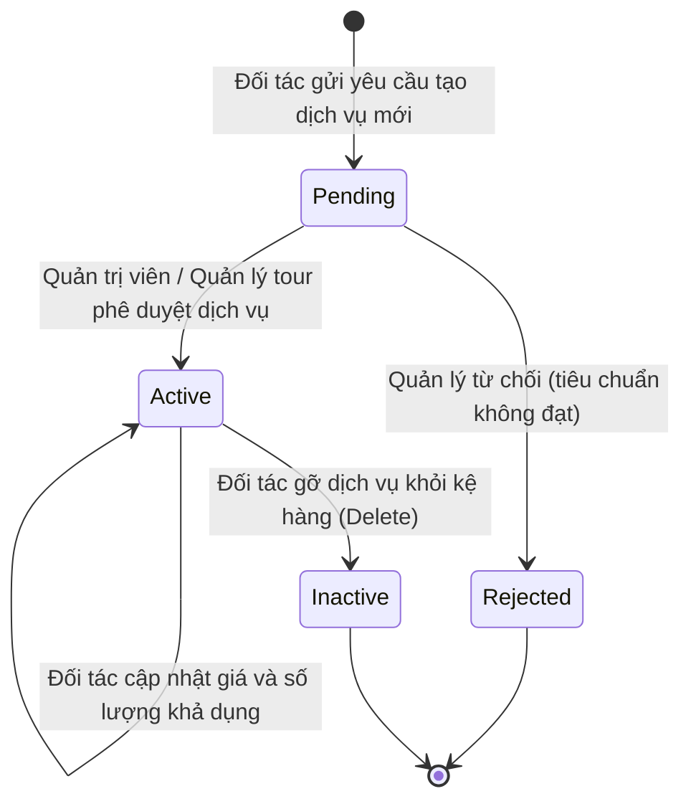
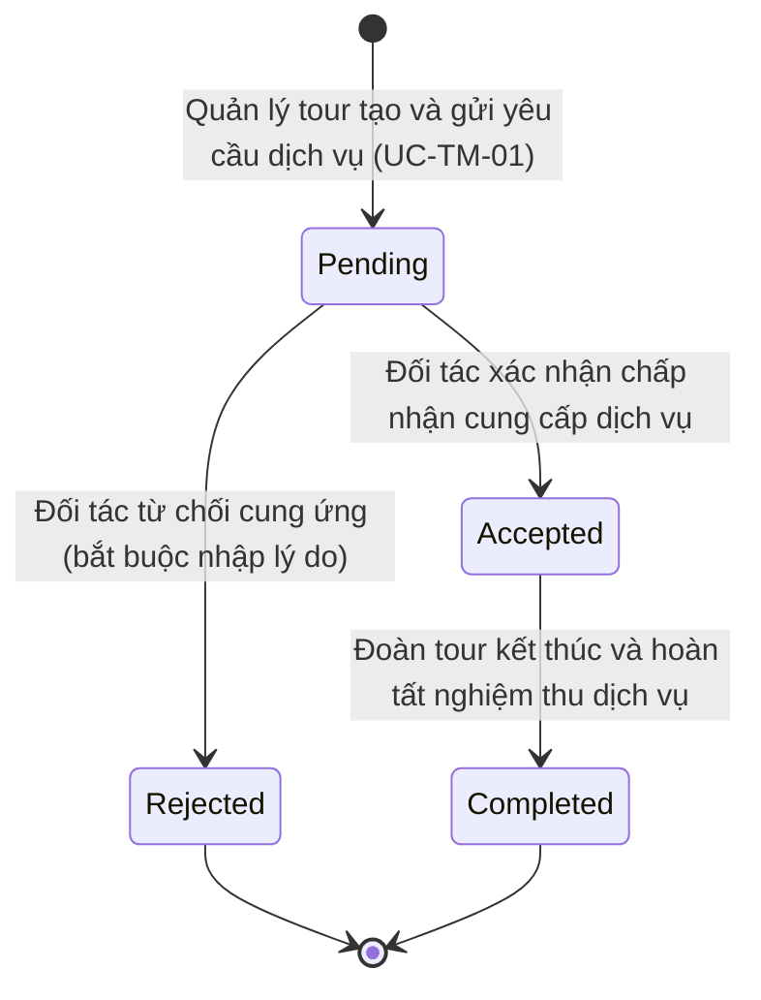

# BÁO CÁO PHÂN TÍCH NGHIỆP VỤ VÀ PHẠM VI HỆ THỐNG
## VAI TRÒ: ĐỐI TÁC CUNG ỨNG DỊCH VỤ (PARTNER) – TRAVELVN ERP

---

### 1. Tổng quan vai trò Đối tác trong Hệ thống TravelVN ERP

Trong kiến trúc tổng thể của Hệ thống Quản trị và Điều hành Du lịch **TravelVN ERP**, **Đối tác (Partner - Role ID: 7)** là tác nhân bên ngoài liên kết chiến lược với công ty lữ hành, đại diện cho các đơn vị cung ứng dịch vụ tại các địa phương bao gồm:
- **Cơ sở lưu trú:** Khách sạn, Resort, Homestay (`HOTEL`).
- **Cơ sở ẩm thực:** Nhà hàng, Trung tâm tiệc (`RESTAURANT`).
- **Đơn vị vận tải ngoài:** Doanh nghiệp cho thuê xe du lịch, hãng xe hợp đồng (`TRANSPORTATION`).
- **Điểm vui chơi giải trí & Vé tham quan:** Các khu du lịch, cáp treo, công viên giải trí.

Thay vì phải trao đổi thủ công qua email, điện thoại hoặc văn bản giấy dễ thất lạc và sai lệch số lượng, Cổng dịch vụ đối tác (**Partner Portal**) cho phép các đơn vị cung ứng trực tiếp tương tác với hệ thống điều hành của công ty lữ hành theo thời gian thực: chủ động đăng bán dịch vụ, tiếp nhận lệnh đặt chỗ của đoàn tour, xác nhận giữ chỗ và đối soát số lượng suất/phòng phục vụ.

---

### 2. Ma trận phân nhiệm trách nhiệm (RACI Matrix)

*Quy ước:*
- **R (Responsible):** Người trực tiếp thực hiện tác vụ.
- **A (Accountable):** Người chịu trách nhiệm phê duyệt cuối cùng và kết quả tác vụ.
- **C (Consulted):** Người được tham vấn, phối hợp cung cấp thông tin.
- **I (Informed):** Người nhận thông báo kết quả.

| Use Case Nghiệp Vụ | Đối Tác (Partner) | Quản Lý Tour (Tour Manager) | Quản Trị Viên (Admin) | Nhân Viên Văn Phòng (Office Staff) |
| :--- | :---: | :---: | :---: | :---: |
| **`UC-PT-01: Quản lý kho dịch vụ đối tác`** | **R / A** | C / A (Duyệt) | A | I (Tra cứu để thiết kế tour) |
| **`UC-PT-02: Tiếp nhận và xử lý yêu cầu dịch vụ`** | **R / A** | R (Gửi lệnh) / I | I | I (Theo dõi đợt khởi hành) |
| **`UC-PT-03: Xem tổng hợp cung cấp dịch vụ`** | **R** | I | I | - |

---

### 3. Phân tích chi tiết phạm vi nghiệp vụ và luồng xử lý

#### 3.1. UC-PT-01: Quản lý kho dịch vụ đối tác
- **Đăng ký dịch vụ mới:**
  - Đối tác chủ động tải thông tin dịch vụ (tên dịch vụ, đơn vị tính, sức chứa phòng/bàn/xe, đơn giá đề xuất và hình ảnh đại diện) lên hệ thống.
  - Cơ chế kiểm soát: Nhằm bảo đảm uy tín thương hiệu và an toàn cho du khách, dịch vụ mới tạo không được tự động mở bán ngay mà được lưu ở trạng thái Chờ duyệt (`Pending`) để Quản trị viên hoặc Quản lý tour thẩm định.
- **Điều chỉnh giá và quỹ số lượng khả dụng:**
  - Khi thị trường du lịch biến động theo mùa vụ (mùa cao điểm, thấp điểm hoặc lễ tết), đối tác có thể cập nhật linh hoạt mức giá và công suất cung cấp tối đa đối với các dịch vụ đang hoạt động (`Active`).
  - Hệ thống bảo toàn tính toàn vẹn: Các đơn đặt dịch vụ hoặc báo giá tour đã xác nhận trước thời điểm đổi giá sẽ không bị ảnh hưởng.

#### 3.2. UC-PT-02: Tiếp nhận và xử lý yêu cầu dịch vụ
- **Luồng nghiệp vụ tiếp nhận yêu cầu từ Quản lý Tour:**
  1. Quản lý tour lập nhóm yêu cầu dịch vụ (`service_request_groups`) cho một đợt khởi hành cụ thể (`UC-TM-01`).
  2. Hệ thống tự động phân tách thành các bản ghi yêu cầu dịch vụ độc lập (`service_requests`) theo từng đối tác và gửi thông báo nội bộ tới tài khoản của đối tác.
  3. Đối tác đăng nhập vào Cổng dịch vụ, kiểm tra chi tiết đoàn tour: Số lượng khách, ngày đi, ngày về, số buồng phòng hoặc số suất ăn cần chuẩn bị.
- **Xử lý phản hồi từ đối tác:**
  - **Chấp thuận (`Accepted`):** Đối tác xác nhận đảm bảo đủ năng lực cung cấp. Hệ thống ghi nhận trạng thái và gửi thông báo xác nhận tự động tới công ty lữ hành.
  - **Từ chối (`Rejected`):** Khi cơ sở đã kín buồng phòng hoặc hết bàn ăn trong ngày đoàn đến, đối tác bấm Từ chối và bắt buộc nhập lý do cụ thể. Hệ thống gửi cảnh báo cho Quản lý tour để chủ động tìm đối tác khác thay thế, tránh rủi ro vỡ tour.

#### 3.3. UC-PT-03: Xem tổng hợp cung cấp dịch vụ
- **Thống kê chuyên biệt theo từng loại hình dịch vụ:**
  - Giao diện báo cáo tự động nhận diện nhóm chuyên môn của đối tác (`partner_group`):
    + Đối với Khách sạn (`HOTEL`): Phân loại và tổng hợp chi tiết theo từng hạng phòng (Standard, Superior, Deluxe, Suite, Family) để lễ tân dễ dàng chuẩn bị chìa khóa phòng trước khi đoàn đến.
    + Đối với Nhà hàng (`RESTAURANT`): Tổng hợp số suất ăn theo từng bữa (sáng, trưa, tối) theo thực đơn đã thống nhất.
    + Đối với Xe vận chuyển (`TRANSPORTATION`): Thống kê số lượng lượt xe và ngày phục vụ.
- **Theo dõi biến động số lượng khách:**
  - Bóc tách minh bạch giữa Yêu cầu gốc ban đầu (`INITIAL`) và Yêu cầu bổ sung cận ngày (`SUPPLEMENT`) do đoàn chốt tăng thêm khách, giúp bộ phận kế toán của hai bên dễ dàng đối soát hóa đơn công nợ chính xác.

---

### 4. Biểu đồ trạng thái dữ liệu (State Diagrams)

#### 4.1. Vòng đời Dịch vụ của Đối tác (UC-PT-01)

#### 4.2. Vòng đời Xử lý Yêu cầu Dịch vụ (UC-PT-02)

---

### 5. An toàn và Ranh giới dữ liệu (Data Isolation & Security)

1. **Phân quyền chặt chẽ theo vai trò và nhóm đối tác (`partner_group`):**
   - Tài khoản đối tác chỉ có quyền xem và thao tác trên các bản ghi thuộc sở hữu của chính đơn vị mình, được nhận diện qua `user_id` và `partner_group` (khách sạn chỉ thấy dữ liệu lưu trú, nhà hàng chỉ thấy dữ liệu ăn uống).
   - Hệ thống chặn hoàn toàn việc đối tác truy cập vào thông tin khách hàng cá nhân, giá bán lẻ của tour hay danh mục đối tác cạnh tranh.
2. **Khép kín thông tin nội bộ:**
   - Mọi tương tác yêu cầu và phản hồi đều được lưu vết thời gian và mã người thực hiện, phục vụ giải quyết tranh chấp hoặc kiểm toán chất lượng dịch vụ khi có sự cố phát sinh.

---
*Tài liệu được kết xuất từ mã nguồn TravelVN ERP phục vụ Báo cáo Khóa luận Tốt nghiệp ngành Hệ thống Thông tin.*
