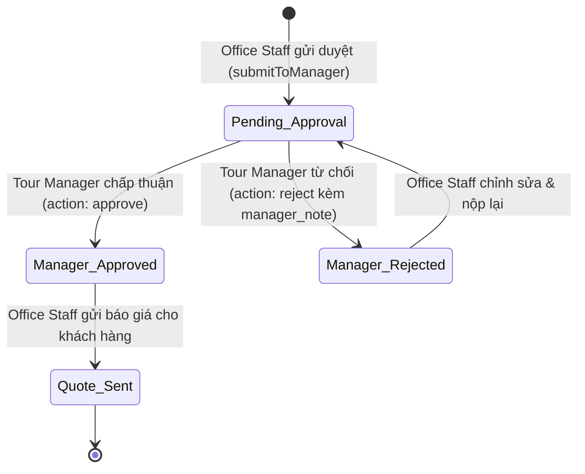
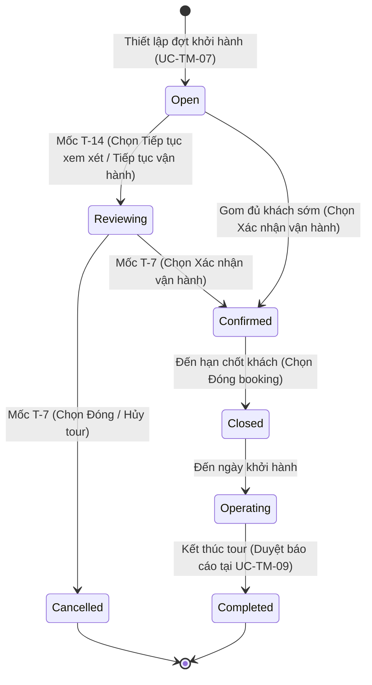
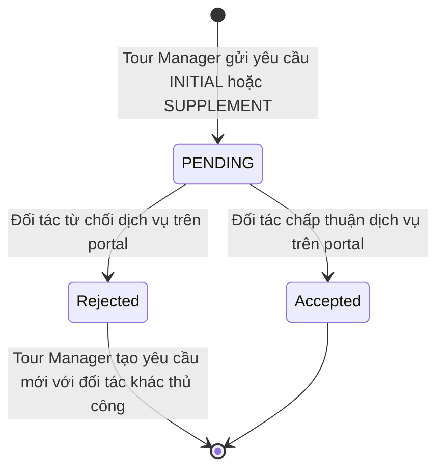
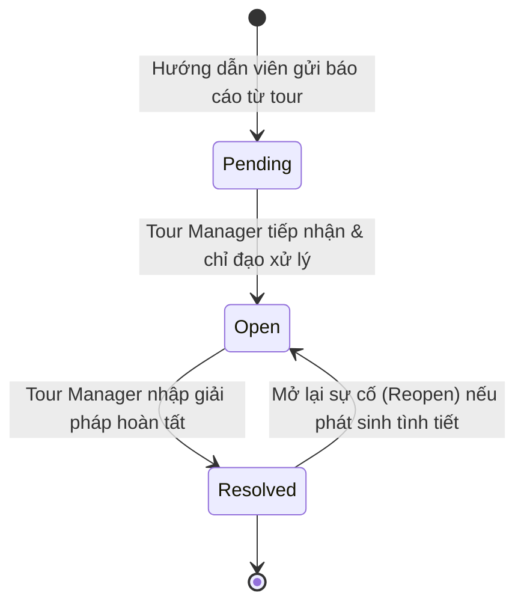

# BÁO CÁO PHÂN TÍCH NGHIỆP VỤ VÀ PHẠM VI HỆ THỐNG
## VAI TRÒ: QUẢN LÝ TOUR (TOUR MANAGER) – TRAVELVN ERP

---

### 1. Tổng quan vai trò Quản lý Tour trong Hệ thống TravelVN ERP

Trong mô hình kiến trúc phân hệ nghiệp vụ của TravelVN ERP, **Quản lý tour (Tour Manager - Role ID: 3)** là tác nhân nghiệp vụ chuyên môn chịu trách nhiệm quản lý vòng đời sản phẩm du lịch, điều phối nguồn lực nội bộ, kiểm soát chuỗi cung ứng dịch vụ đối tác và ra quyết định vận hành các đoàn tour.

Khác với **Nhân viên văn phòng (Office Staff - Role ID: 4)** vốn tập trung vào giao diện tiếp xúc khách hàng (tư vấn trực tuyến, đặt chỗ, thu tiền, hủy/đổi lịch và phác thảo ý tưởng tour), Quản lý tour tập trung vào:
1. **Quản trị sản phẩm và Thẩm định kinh tế tour:** Giám sát danh mục tour toàn công ty, thẩm duyệt phương án tài chính và cơ cấu định phí/biến phí/margin của bản thiết kế tour trước khi phát hành ra thị trường.
2. **Kế hoạch lịch trình và Điều phối nguồn lực nội bộ:** Lên lịch các đợt khởi hành định kỳ, phân công Hướng dẫn viên và Xe nội bộ.
3. **Giám sát gom khách và Quyết định vận hành:** Đánh giá số lượng khách theo các mốc thời gian T-21, T-14, T-7 so với điểm hòa vốn để quyết định khởi hành hay đóng tour.
4. **Quản trị chuỗi cung ứng dịch vụ:** Phát hành các nhóm yêu cầu dịch vụ ban đầu và bổ sung tới các nhà cung cấp Khách sạn, Nhà hàng, Vận tải.
5. **Quản trị rủi ro và Kiểm soát chất lượng:** Xử lý sự cố thực địa phát sinh trên tour, phê duyệt báo cáo hoàn tất chuyến đi và theo dõi báo cáo thống kê hoạt động lữ hành.

---

### 2. Ma trận phân định trách nhiệm RACI giữa các tác nhân

Ma trận RACI chuẩn hóa phân định quyền hạn giữa các vai trò trong chuỗi giá trị du lịch của TravelVN ERP:
- **R (Responsible):** Người trực tiếp thực hiện công việc.
- **A (Accountable):** Người chịu trách nhiệm phê duyệt và kết quả nghiệp vụ cuối cùng.
- **C (Consulted):** Người được tham vấn chuyên môn.
- **I (Informed):** Người nhận thông tin kết quả.

| Nhóm nghiệp vụ / Use Case | Tour Manager (Role 3) | Office Staff (Role 4) | Admin (Role 1) | Tour Guide (Role 5) | Driver (Role 8) | Partner (Role 7) | Customer (Role 6) |
| :--- | :---: | :---: | :---: | :---: | :---: | :---: | :---: |
| Tư vấn & Tiếp nhận yêu cầu tour | I | **A / R** | I | - | - | - | R |
| Phác thảo thiết kế tour riêng/cố định | C | **A / R** | - | - | - | - | C |
| **UC-TM-05: Phê duyệt thiết kế tour** | **A / R** | C | I | - | - | - | I |
| **UC-TM-02: Quản lý tour (Danh mục, giá, đóng/mở)** | **A / R** | I | C | - | - | - | I |
| **UC-TM-03: Quản lý đối tác** | **A / R** | - | C | - | - | I | - |
| **UC-TM-04: Quản lý xe (Hồ sơ đội xe nội bộ)** | **A / R** | I (Xem danh sách) | C | - | - | - | - |
| Theo dõi & Cập nhật trạng thái kỹ thuật xe (`UC-OS-06A`) | A / I | **R** (Bảo dưỡng/Sửa chữa) | I | - | I | - | - |
| Tiếp nhận & Xử lý sự cố kỹ thuật xe (`UC-OS-06B`) | C (Điều phối đổi xe nếu đang đi tour) | **A / R** (Xử lý sự cố) | I | - | **R** (Báo sự cố) | - | - |
| **UC-TM-07: Thiết lập lịch trình tour** | **A / R** | I | I | I (Nhận phân công) | I (Nhận phân công) | - | - |
| Gom khách, bán vé, thu tiền | I | **A / R** | - | - | - | - | R |
| **UC-TM-08: Thiết lập vận hành tour (Mốc T-21/14/7)** | **A / R** | I (Theo dõi lịch) | I | I | I | - | - |
| **UC-TM-01: Gửi yêu cầu cung cấp dịch vụ** | **A / R** | - | - | - | - | **A / R (Phản hồi)** | - |
| Vận hành thực địa & Báo cáo sự cố | I | - | - | **A / R (Báo cáo)** | **A / R (Báo cáo)** | - | - |
| **UC-TM-06: Xử lý sự cố tour** | **A / R** | I | I | C | C | C | - |
| **UC-TM-09: Xem báo cáo thống kê & Duyệt tour** | **A / R** | I | **A** | I | I | I | - |

---

### 3. Phân tích chi tiết quy tắc nghiệp vụ cho 9 Use Case

#### 3.1. UC-TM-01: Gửi yêu cầu cung cấp dịch vụ
- **Bản chất nghiệp vụ:** Khi đợt khởi hành đã được lên lịch hoặc xác nhận vận hành, Tour Manager tạo lập yêu cầu dịch vụ gửi tới các nhà cung cấp bên ngoài nhằm chốt giữ chỗ lưu trú, ăn uống và phương tiện ngoài.
- **Mô hình dữ liệu Nhóm yêu cầu (Group - Child):**
  - Hệ thống sử dụng quan hệ 1-N giữa `service_request_groups` và `service_requests`.
  - Một nhóm yêu cầu (`service_request_groups`) gắn liền với một đợt khởi hành cụ thể (`departure_id`) và số lượng khách của đoàn (`passenger_count`).
  - Hệ thống tự động bóc tách nhóm yêu cầu thành các yêu cầu con (`service_requests`) gửi riêng biệt cho từng đối tác (`partner_id`) theo từng loại dịch vụ (`HOTEL`, `RESTAURANT`, `TRANSPORTATION`).
- **Phân loại yêu cầu:**
  1. `INITIAL` (Ban đầu): Khởi tạo danh sách các dịch vụ cần thiết cho toàn đoàn theo kế hoạch khởi hành.
  2. `SUPPLEMENT` (Bổ sung): Được lập khi đợt khởi hành phát sinh tăng khách cận ngày (chỉ ghi nhận số lượng phòng/suất ăn chênh lệch bổ sung).
- **Cơ chế tương tác với đối tác và giới hạn kỹ thuật:**
  - Đối tác đăng nhập vào hệ thống TravelVN ERP qua cổng portal dành riêng cho đối tác (`PartnerServiceRequests.jsx`).
  - Đối tác xem nội dung yêu cầu và phản hồi: Chấp thuận (`Accepted`) hoặc Từ chối (`Rejected`) kèm ghi chú lý do.
  - Khi một đối tác từ chối yêu cầu, hệ thống **không có cơ chế tự động chuyển yêu cầu sang đối tác khác**. Quản lý tour cần theo dõi danh sách yêu cầu thủ công và tự tạo yêu cầu mới với đối tác thay thế nếu cần.
  - Hệ thống chỉ gửi thông báo nội bộ qua bảng `notifications` đến tài khoản đối tác trong hệ thống; không gửi email hay tin nhắn SMS ra bên ngoài.

#### 3.2. UC-TM-02: Quản lý tour
- **Bảo toàn dữ liệu thương mại:**
  - Sản phẩm tour liên kết với các bảng dữ liệu `itineraries`, `itinerary_activities`, `departures` và `bookings`.
  - Hệ thống kiểm soát tính toàn vẹn dữ liệu: Khi thực hiện lệnh xóa tour (`DELETE /api/tours/:id`), nếu tour đã phát sinh dữ liệu liên kết tại bảng `departures` hoặc `bookings`, cơ sở dữ liệu sẽ chặn xóa do ràng buộc khóa ngoại (mã lỗi 1451) và backend trả về thông báo từ chối.
- **Điều chỉnh giá niêm yết:**
  - Tour Manager có quyền điều chỉnh giá bán niêm yết của tour cố định (`PUT /api/tours/admin/price/:id`).
  - Giá mới cập nhật chỉ áp dụng cho các booking phát sinh sau thời điểm thay đổi; các booking đã đặt trước đó giữ nguyên giá trị hợp đồng ban đầu.
- **Đóng / Mở bán sản phẩm:**
  - Thao tác chuyển đổi trạng thái `Active` $\leftrightarrow$ `Inactive` cho phép ẩn hoặc hiển thị sản phẩm trên cổng đặt tour công khai.

#### 3.3. UC-TM-03: Quản lý đối tác
- **Phân loại đối tác:**
  - Bảng `partners` phân loại đối tác theo 5 loại hình dịch vụ chính:
    1. `HOTEL`: Cơ sở lưu trú, khách sạn, resort.
    2. `RESTAURANT`: Nhà hàng, trung tâm ẩm thực.
    3. `TRANSPORTATION`: Nhà xe ngoài, dịch vụ vận chuyển hành khách.
    4. `SIGHTSEEING`: Điểm tham quan, khu vui chơi bán vé.
    5. `LOCAL_GUIDE`: Hướng dẫn viên bản địa, đối tác hướng dẫn viên cộng tác.
- **Hồ sơ liên hệ và giới hạn kỹ thuật:**
  - Lưu trữ thông tin người đại diện, số điện thoại liên hệ, email, địa chỉ kinh doanh và tỉnh/thành phố (`destination_id`).
  - Bảng `partners` hiện tại không có cột trạng thái (`status`) và giao diện không có nút toggle kích hoạt/vô hiệu hóa. Thao tác xóa đối tác là xóa vật lý (`DELETE FROM partners WHERE partner_id = ?`) và bị chặn nếu đối tác đã có liên kết trong bảng `service_requests`.

#### 3.4. UC-TM-04: Quản lý xe
- **Phân định rõ ràng giữa Xe vật lý nội bộ và Dịch vụ vận chuyển:**
  - **Bảng `vehicles`:** Lưu thông tin từng chiếc xe vật lý thuộc đội xe sở hữu của công ty lữ hành (Biển số xe `license_plate`, loại xe `vehicle_type`, số chỗ ngồi `seat_capacity`, màu sơn, tình trạng kỹ thuật).
  - **Bảng `services`:** Lưu danh mục gói dịch vụ thương mại được bán cho khách hàng hoặc ký hợp đồng với đối tác (có trường `service_type = 'Xe vận chuyển'`).
  - Hệ thống liên kết giữa xe nội bộ và dịch vụ qua khóa ngoại `vehicles.service_id`.
- **Ranh giới quyền hạn giữa Quản lý Tour (`UC-TM-04`, `UC-TM-07`) và Nhân viên văn phòng (`UC-OS-06A`, `UC-OS-06B`):**
  - **Quản lý Tour (`role_id = 3`):** Độc quyền quản lý hồ sơ phương tiện (Thêm mới `POST /api/tours/fleet/vehicles`, Sửa hồ sơ & giá vốn/giá bán `PUT /api/tours/fleet/vehicles/:id`, Xóa phương tiện `DELETE /api/tours/fleet/vehicles/:id`, Ngừng khai thác `INACTIVE`) và điều phối/thay thế xe cho các chuyến đi (`tour_vehicle_assignments` tại `UC-TM-07`).
  - **Nhân viên văn phòng (`role_id = 4`):** Không được phép thêm, sửa hồ sơ hoặc xóa phương tiện; chỉ thực hiện theo dõi, cập nhật trạng thái kỹ thuật hợp lệ (`AVAILABLE` $\leftrightarrow$ `MAINTENANCE`/`REPAIR` tại `UC-OS-06A`) và tiếp nhận, xử lý báo cáo sự cố xe từ Tài xế (`driver_incidents` tại `UC-OS-06B`). Khi xe đang chạy tour (`IN_TOUR`) gặp sự cố nặng không thể tiếp tục hành trình, Quản lý Tour chịu trách nhiệm điều phối xe thay thế trước khi xe hỏng được chuyển sang `REPAIR`.
- **Kiểm tra trùng lặp và trạng thái kỹ thuật:**
  - Backend `vehicleController.js` kiểm tra trùng biển số xe trước khi tạo mới (`SELECT vehicle_id FROM vehicles WHERE license_plate = ?`).
  - Trạng thái kỹ thuật của xe nội bộ:
    - `AVAILABLE`: Xe sẵn sàng phân công vào tour.
    - `MAINTENANCE`: Xe đang trong kế hoạch bảo dưỡng định kỳ (có bản ghi trong `vehicle_maintenances`).
    - `REPAIR`: Xe đang sửa chữa khắc phục sự cố kỹ thuật.
    - `IN_TOUR`: Xe đang phục vụ đoàn thực tế trên hành trình (trạng thái do hệ thống quản lý theo lịch điều phối, không cho phép chuyển đổi thủ công).
    - `INACTIVE`: Xe tạm ngừng khai thác (thuộc thẩm quyền Quản lý Tour).

#### 3.5. UC-TM-05: Phê duyệt thiết kế tour
- **Thẩm định cấu trúc tài chính và tính khả thi:**
  - Tour riêng do Office Staff xây dựng được bóc tách thành Định phí (xe, HDV), Biến phí (phòng, ăn, vé, bảo hiểm) và Biên lợi nhuận (Margin %).
- **Quy tắc phê duyệt và phản hồi:**
  - Nếu bản thiết kế đạt yêu cầu: Quản lý nhấn Phê duyệt (`Approve`), hàm `managerReview` cập nhật `custom_tour_quotes.approval_status = 'Approved'`, cập nhật `custom_tour_requests.status = 'Manager_Approved'`.
  - Nếu bản thiết kế chưa tối ưu: Quản lý nhấn Từ chối (`Reject`) và có thể nhập lý do góp ý (`manager_note`). Hàm `managerReview` cập nhật `custom_tour_quotes.approval_status = 'Rejected'`, lưu `manager_note`, cập nhật `custom_tour_requests.status = 'Manager_Rejected'`.
  - **Giới hạn kỹ thuật:** Hàm `managerReview` chỉ cập nhật dữ liệu vào cơ sở dữ liệu, không có lệnh tạo thông báo tự động (notification/email) gửi cho nhân viên. Nhân viên theo dõi tiến độ qua danh sách yêu cầu tại giao diện làm việc.
- **Phê duyệt tour cố định:**
  - Đối với tour cố định thiết kế mới đang ở trạng thái `Pending`, Quản lý Tour duyệt mở bán bằng cách chuyển trạng thái sang `Active`.

#### 3.6. UC-TM-06: Xử lý sự cố tour
- **Tiếp nhận sự cố thực địa:**
  - Sự cố do Hướng dẫn viên gửi về từ ứng dụng thực địa trong quá trình phục vụ đoàn tour, được lưu vào bảng `incident_reports`.
  - Báo cáo gồm: Đợt khởi hành (`departure_id`), Hướng dẫn viên báo cáo (`guide_id`), Tiêu đề, Mô tả chi tiết và Trạng thái (`Pending` hoặc `Open`).
- **Quy trình xử lý và giới hạn kỹ thuật:**
  - Quản lý tiếp nhận sự cố: Xem nội dung chi tiết.
  - Quản lý chỉ đạo giải quyết: Trao đổi với HDV và đối tác tại địa phương để xử lý tại chỗ.
  - Xác nhận hoàn tất: Quản lý nhập giải pháp (`resolution_notes`) và chuyển trạng thái sang `Resolved`. Có thể mở lại (`Reopen`) nếu phát sinh tình tiết mới.
  - **Giới hạn kỹ thuật:** Bảng `incident_reports` hiện tại chỉ lưu trữ `status` và `resolution_notes`. Không có trường chi phí bồi thường (`additional_cost`) hay cơ chế tự động hoàn tiền/bồi thường trong bảng này. Các vấn đề tài chính phát sinh do bộ phận kế toán xử lý độc lập.

#### 3.7. UC-TM-07: Thiết lập lịch trình tour
- **Thiết lập đợt khởi hành (`departures`):**
  - Quản lý chọn tour và cấu hình: Ngày khởi hành (`departure_date`), ngày về (`return_date`), số chỗ tối đa mở bán (`max_slots`), gán Hướng dẫn viên, gán Xe nội bộ và Tài xế.
- **Phân định nơi kiểm tra các quy tắc nghiệp vụ:**
  - *Ngày trong quá khứ:* Được kiểm tra ở cả Frontend và Backend. Backend từ chối lưu và trả về lỗi 400 nếu ngày khởi hành hoặc ngày về nhỏ hơn ngày hiện tại.
  - *Đợt khởi hành đã kết thúc:* Backend từ chối sửa đổi HDV/xe/ngày đối với đợt khởi hành đã qua ngày kết thúc hoặc ở trạng thái `Closed`/`Completed`.
  - *Tính ngày kết thúc:* Được tính toán tự động tại Frontend dựa trên `departure_date` và `duration_days` của tour.
  - *Kiểm tra trùng lịch Hướng dẫn viên:* Được thực hiện tại Frontend bằng cách gọi API `GET /api/tours/admin/guide-schedule` và đánh dấu cảnh báo bận trên giao diện. Backend hiện tại không chặn lưu nếu có trùng lặp.
  - *Kiểm tra khoảng đệm xe:* Được tính toán tại Frontend và trong API `getVehicles` để lọc hiển thị xe khả dụng.

#### 3.8. UC-TM-08: Thiết lập vận hành tour
- **Mô hình đếm ngược các mốc vận hành (Milestones):**
  - Giao diện `TourOperations.jsx` tự động tính toán các mốc ngày dựa trên hiệu số giữa ngày khởi hành và ngày hiện tại (`days_until`):
    - **Mốc T-21 (`PRE_T21`, `T21`):** Còn trên 14 ngày, theo dõi tốc độ gom khách.
    - **Mốc T-14 (`T14`):** Còn từ 8 đến 14 ngày, đánh dấu "Cần xem xét" (`needs_review`).
    - **Mốc T-7 (`T7`):** Còn từ 1 đến 7 ngày, mốc chốt đóng booking.
- **Quyết định vận hành và giới hạn kỹ thuật:**
  - Các thao tác: `Xác nhận vận hành` (chuyển `operational_status = 'Confirmed'`), `Tiếp tục vận hành` / `Tiếp tục xem xét` (chuyển `operational_status = 'Reviewing'`), `Đóng tour` (chuyển `operational_status = 'Cancelled'`, `status = 'Closed'`), `Đóng booking` (chuyển `status = 'Closed'`).
  - Mọi thao tác đều được lưu vào mảng JSON `decision_history` trong bảng `departures` (thao tác, ghi chú, mã người duyệt, tên người duyệt, số khách tại thời điểm quyết định, thời gian).
  - **Giới hạn kỹ thuật:** Hàm `makeOperationalDecision` chỉ cập nhật các trường trạng thái và `decision_history` trong bảng `departures`. Không có cơ chế tự động gửi thông báo, không có quy trình tự động hoàn tiền hay tự động hủy dịch vụ đối tác. Các công việc này cần được nhân viên thực hiện thủ công ngoài hệ thống.

#### 3.9. UC-TM-09: Xem báo cáo thống kê
- **5 phân hệ báo cáo tại trung tâm `GeneralOverview.jsx`:**
  1. *Báo cáo chuyến đi của HDV (`tour_reports`):* Xem danh sách báo cáo kết thúc chuyến đi từ Hướng dẫn viên (`trip_reports`), hiển thị rating trung bình và có nút duyệt hoàn tất chuyến đi (`PUT /api/guide/reports/:id/approve`). Thao tác duyệt báo cáo chuyến đi là một hành động hành chính được tích hợp trong màn hình này.
  2. *Doanh thu & Bán vé (`revenue`):* Nhúng component `OfficeStaffDashboard.jsx`, hiển thị các chỉ số doanh thu thực tế từ `bookings`, có chức năng xuất báo cáo ra file PDF thông qua thư viện `html2pdf.js`.
  3. *Thống kê nhân sự (`hr_stats`):* Xem thống kê đơn xin nghỉ phép của nhân sự qua `GET /api/hr/leave-requests`.
  4. *Thống kê sự cố (`incidents`):* Tổng hợp các sự cố phát sinh trên toàn bộ các đoàn tour qua `GET /api/guide/incidents/all`.
  5. *Đánh giá đối tác (`partners`):* Theo dõi chất lượng cung cấp dịch vụ của các đối tác lữ hành.

---

### 4. Biểu đồ trạng thái dữ liệu (State Diagrams)

#### 4.1. Vòng đời Phê duyệt Báo giá Tour riêng (UC-TM-05)

#### 4.2. Vòng đời Điều hành Đợt khởi hành (UC-TM-07 & UC-TM-08)

#### 4.3. Vòng đời Yêu cầu dịch vụ đối tác (UC-TM-01)

#### 4.4. Vòng đời Xử lý Sự cố Đoàn Tour (UC-TM-06)

---

### 5. Kết luận phân tích

Hệ thống TravelVN ERP cung cấp giao diện và dịch vụ backend đáp ứng 9 Use Case cơ sở của vai trò Quản lý tour. Báo cáo phân tích này đã làm rõ ranh giới giữa chức năng tự động của hệ thống và các thao tác thủ công của người dùng, phân định rõ phạm vi kiểm tra giữa Frontend và Backend, làm cơ sở tin cậy cho tài liệu kiểm toán và đặc tả Use Case.

---
*Tài liệu được kết xuất từ mã nguồn TravelVN ERP phục vụ Báo cáo Khóa luận Tốt nghiệp ngành Hệ thống Thông tin.*
